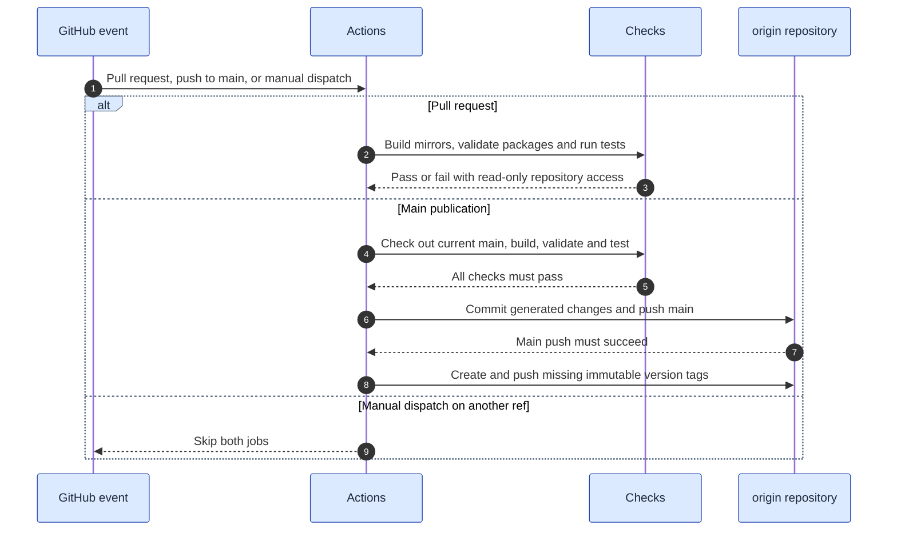
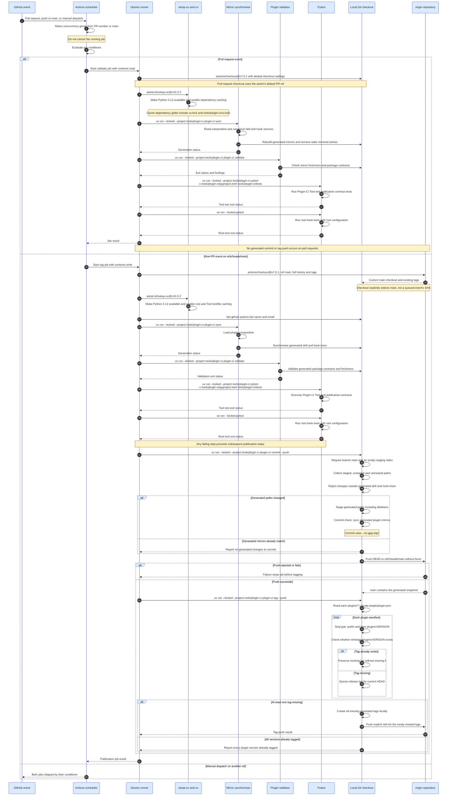

# Plugin publication workflow

[`tag-plugin-versions.yml`](tag-plugin-versions.yml) validates generated plugin packages on pull requests and publishes generated mirrors and version tags from `main`.
Canonical sources are `skills/`, `hooks/` and [`plugins/composition.yaml`](../../plugins/composition.yaml).
Generated mirrors live under `plugins/<plugin>/skills/` and `plugins/<plugin>/hooks/`.

## Triggers and routing

| Event | Validation job | Publication job |
|---|---|---|
| Pull request | Runs with read-only repository contents access | Skipped |
| Push to `main` | Skipped | Runs with repository contents write access |
| Manual dispatch on `main` | Skipped | Runs with repository contents write access |
| Manual dispatch on another ref | Skipped | Skipped |

The workflow grants `contents: read` by default. Only the publication job overrides this with `contents: write`.
Both jobs use `ubuntu-latest`.
Concurrency groups are `plugin-publication-<pull-request-number>` for pull requests and `plugin-publication-main` for publication.
`cancel-in-progress: false` keeps the running job active. GitHub can replace an older pending run in the same group, so not every queued run is retained.

## Workflow overview

Pull requests prove that canonical sources generate valid plugins.
Publication on `main` repeats those checks, commits generated mirrors, then creates missing version tags.



<details>
<summary>Complete validation and publication sequence</summary>

### Detailed workflow sequence

Blue participant boxes identify workflow components. Amber notes identify constraints and decisions.
Message colours follow the reader's GitHub theme.



</details>

## Generation and validation contracts

The synchroniser copies canonical skill trees according to composition and copies the configured hook files.
It excludes configured development artefacts and `evals/`, and removes stale generated entries.
It does not update plugin versions.

The validator checks symlink restrictions, exact mirror freshness, composition membership, hook wiring, Claude and Codex manifests, skill frontmatter and marketplace metadata.
The publication test step runs the Plugin CI Tool suite with its own explicit pytest configuration, then runs root hook tests.
Both invocations must pass before publication continues.
A successful synchronisation step alone does not establish package validity: validation and tests must also succeed.

## Commit and release boundaries

The generated-commit helper accepts changes only below `plugins/<plugin>/skills/` or `plugins/<plugin>/hooks/`.
Manifests, composition, plugin READMEs and canonical source changes are authored inputs and cannot enter this automatic commit.
It refuses another branch, a pre-populated index or unrelated dirty files.
The push also runs when no generated commit was necessary.
A concurrent update to remote `main` can reject the normal push; the helper does not force-push, rebase or retry.

Version tags derive from the Claude plugin manifests. For example, `jpai-essentials` version `1.2.3` produces `essentials/v1.2.3`.
Missing tags are annotated and target the checked-out HEAD after any generated commit.
Existing tags are immutable under this helper: it skips their names without retargeting them or comparing their commits.
Version numbers must therefore be updated explicitly in the authored manifest change when a new release tag is needed.

Publication is ordered but not transactional.
The generated commit can reach `main` before a later tag operation fails.
New tags are pushed together without `--atomic`, so a failed push requires inspecting the remote tag state before retrying.
A fresh run checks out remote `main` and fetches tags again, allowing it to skip tags already present remotely.

Pushes made with the workflow's repository token do not recursively trigger another ordinary push workflow run.
This workflow publishes Git commits and tags; it does not create GitHub Releases, publish registry packages or run live harness installation tests.

## Maintenance

Keep this sequence aligned with the workflow YAML and the invoked helpers when commands, guards, permissions or publication order change.
Use the root contribution checks for documentation. For this deliberately detailed diagram, run parsing and contrast validation with complexity disabled:

```sh
bunx @jpeakai/mermaidjs-lint .github/workflows/README.md --disable-category complexity
```
