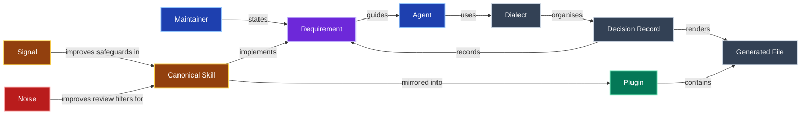

# Glossary

The ubiquitous language for this skill repository.
Use each Title Case term for its defined meaning rather than introducing a synonym.
Add new domain terms here in the same change that introduces them.
Give each term its own alphabetical H2 and a node in the relationship diagram.

## Agent

A coding assistant working under [AGENTS.md](AGENTS.md) and applicable scoped instructions.

## Canonical Skill

The authoritative skill directory under `skills/`, containing runtime instructions and supporting resources.
Plugins contain generated copies of Canonical Skills.

## Decision Record

A decision and its reasoning captured in the root [ADR surface](adrs/index.md) or an existing scoped decision log.
An accepted argument remains immutable; a later Decision Record can supersede it.

## Dialect

The declared documentation layout and naming conventions in [docs/CONVENTIONS.md](docs/CONVENTIONS.md).

## Generated File

A file produced from an authoritative source by a documented regeneration command.
Edit the source, then regenerate the file.

## Maintainer

The person responsible for the repository's Requirements and accepted decisions.

## Noise

Review feedback that lacks actionable evidence or distracts from the pull request's intent.
The resulting lesson improves the filter for future reviews.

## Plugin

An installable composition of Canonical Skills and optional hooks, declared in `plugins/composition.yaml`.

## Requirement

A behavior or constraint explicitly required by the Maintainer.

## Signal

Review feedback supported by evidence and worth acting on within the pull request's intent.
The resulting fix strengthens safeguards against that category of problem.
