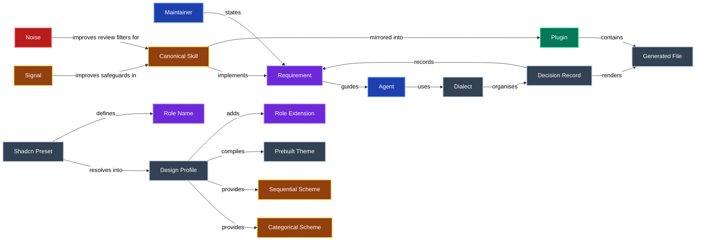

# Glossary

The ubiquitous language for this skill repository.
Use each Title Case term for its defined meaning rather than introducing a synonym.
Add new domain terms here in the same change that introduces them.
Give each term its own alphabetical H2 and a node in the relationship diagram.

## Agent

A coding assistant working under [AGENTS.md](AGENTS.md) and applicable scoped instructions.

## Canonical Skill

The authoritative skill directory under `skills/`, containing runtime instructions and supporting resources.
Plugins contain generated copies of Canonical Skills.

## Categorical Scheme

A color palette used to distinguish unordered groups.
Design Profiles use a golden-angle hue walk to generate categorical chart roots.

## Decision Record

A decision and its reasoning captured in the root [ADR surface](adrs/index.md) or an existing scoped decision log.
An accepted argument remains immutable; a later Decision Record can supersede it.

## Design Profile

A shared set of colors, typography, chart palettes, and rendering surfaces for light and dark modes.
The design-profiles skill curates its editable inputs and exports CSS and DTCG design tokens.

## Dialect

The declared documentation layout and naming conventions in [docs/CONVENTIONS.md](docs/CONVENTIONS.md).

## Generated File

A file produced from an authoritative source by a documented regeneration command.
Edit the source, then regenerate the file.

## Maintainer

The person responsible for the repository's Requirements and accepted decisions.

## Noise

Review feedback that lacks actionable evidence or distracts from the pull request's intent.
The resulting lesson improves the filter for future reviews.

## Plugin

An installable composition of Canonical Skills and optional hooks, declared in `plugins/composition.yaml`.

## Prebuilt Theme

A theme compiled from a canonical design-profile seed and shipped with a consumer skill for use without a project profile.
Its CSS and matching tokens are regenerated together through the design-profiles CLI.

## Requirement

A behavior or constraint explicitly required by the Maintainer.

## Role Extension

A colour role shadcn has no variable for, named in shadcn's grammar and documented as an extension.
The extensions are:

- `link`: brand-coloured text that is readable on the page.
- `faint-foreground`: text quieter than `muted-foreground`.
- `primary-subtle`: a faint brand tint behind content.
- `border-strong`: a border that must stay visible.
- `selected`: the fill of a selected item.

## Role Name

A shadcn theme-variable name used for a colour role on every consumer-facing surface, such as `primary` or `muted-foreground`.
A plain name is a background; its `-foreground` partner is the text that sits on it.

## Sequential Scheme

A color palette used to represent ordered magnitude.
A Design Profile expands each categorical hue into a five-shade Sequential Scheme.

## Shadcn Preset

A versioned string selecting shadcn theme, font, chart, and component-style options.
The public decoder and registry APIs resolve those choices into a saved Design Profile input.

## Shadcn Surface

The `surface.shadcn` projection of a Design Profile onto shadcn-compatible theme variables.
It records source-token dependencies for colors, charts, fonts and radius so exports and lineage share the same mappings.

## Signal

Review feedback supported by evidence and worth acting on within the pull request's intent.
The resulting fix strengthens safeguards against that category of problem.
