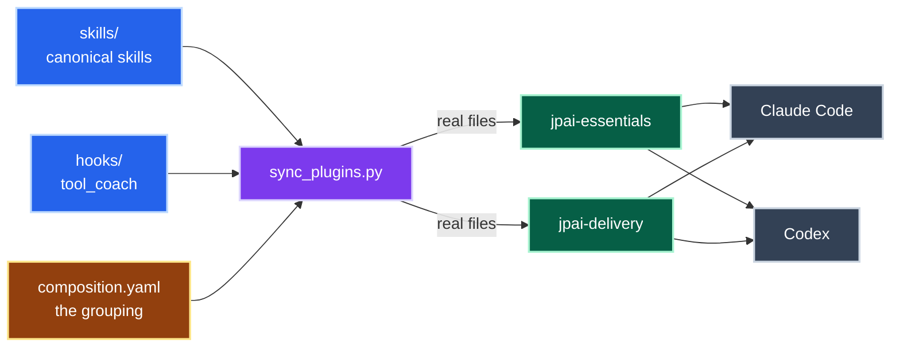
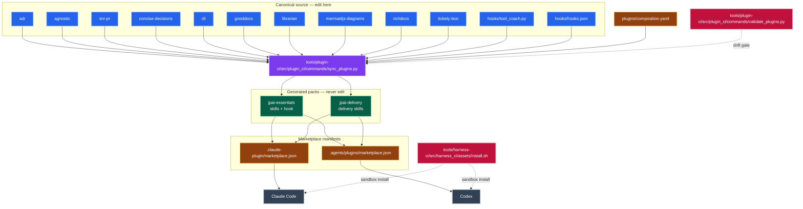

# skills

Agent skills published by [jpeak.ai](https://github.com/jpeakai).
Each directory under `skills/` is one skill: a `SKILL.md` carrying YAML frontmatter, plus whatever resources, scripts and templates it needs.

Contributors: see [CONTRIBUTING.md](CONTRIBUTING.md), [documentation conventions](docs/CONVENTIONS.md), the [glossary](GLOSSARY.md), and the [repository decisions](adrs/index.md).

The skills are published as three installable plugins, so you take the pack you want rather than all of them:

| Plugin | For | Contains |
|---|---|---|
| [`jpai-essentials`](plugins/jpai-essentials) | Documentation and diagrams | `librarian`, `adr`, `gooddocs`, `mermaidjs-diagrams`, `richdocs`, `concise-decisions`, `agnostic`, `tickety-boo`, `snr-pr`, `cli` |
| [`jpai-delivery`](plugins/jpai-delivery) | Review feedback, decisions and ticketing | `snr-pr`, `concise-decisions`, `tickety-boo` |
| [`jpai-ccw`](plugins/jpai-ccw) | Claude Code cloud session setup | `ccw-setup` |

`jpai-essentials` ships the `tool_coach` PreToolUse hook.

## Installing

The two plugin marketplaces install a whole pack, and `jpai-essentials` brings the hook.
The other three routes give you finer control, down to a single skill.

### Claude Code

`.claude-plugin/marketplace.json` registers this repo as a [plugin marketplace](https://code.claude.com/docs/en/plugin-marketplaces).

```
/plugin marketplace add jpeakai/skills
/plugin install jpai-essentials@jpeakai
/plugin install jpai-delivery@jpeakai
/plugin install jpai-ccw@jpeakai
```

To update, refresh the marketplace, then update each pack you installed:

```sh
claude plugin marketplace update jpeakai
claude plugin update jpai-essentials@jpeakai
claude plugin update jpai-delivery@jpeakai
```

An update applies on restart, so start a new session afterwards. `claude plugin list` shows the version each pack is on.

### Codex

`.agents/plugins/marketplace.json` is the repo-scoped marketplace Codex looks for.

```sh
codex plugin marketplace add jpeakai/skills
codex plugin add jpai-essentials@jpeakai
codex plugin add jpai-delivery@jpeakai
```

To update, refresh the marketplace snapshot, then add each pack again:

```sh
codex plugin marketplace upgrade jpeakai
codex plugin add jpai-essentials@jpeakai
codex plugin add jpai-delivery@jpeakai
```

Codex has no update command, because it caches each version of a plugin in its own directory.
Adding a pack again installs the version the refreshed snapshot now carries. `codex plugin list` shows the version each pack is on.

### Kiro

Each pack root carries an [Agent Plugins](https://agent-plugins.org/) `plugin.json`, so Kiro installs it as a power.

```sh
git clone https://github.com/jpeakai/skills.git
kiro-cli powers install "$PWD/skills/plugins/jpai-essentials"
kiro-cli powers install "$PWD/skills/plugins/jpai-delivery"
```

The Kiro IDE imports the same folders through **Add Custom Power**.
A power carries skills but not hooks.
For the hook, the agent profile and workspace skills, clone this repo into a project as `.claude/` and run `make kiro-setup`.
See [kiro-conf/README.md](kiro-conf/README.md).

### npx skills

[`npx skills`](https://github.com/vercel-labs/skills) treats any GitHub repo as the registry, and installs skills into whichever agents it finds.

```sh
npx skills add jpeakai/skills --list              # list available skills, nothing installed
npx skills add jpeakai/skills --skill librarian
npx skills add jpeakai/skills --skill '*' --global
```

It resolves the canonical `skills/` tree and installs individual skills without the hook.
Skills land in the current project unless `--global` sends them to your user directory.
Afterwards use the list, update and remove subcommands to manage installed skills.

### apm

[`apm`](https://github.com/microsoft/apm) is a dependency manager for agents, and takes either a pack or a single skill.

```sh
brew install apm    # or: curl -sSL https://aka.ms/apm-unix | sh

apm install jpeakai/skills/plugins/jpai-essentials --target claude,codex
apm install jpeakai/skills --skill librarian
```

The `jpai-essentials` pack form deploys the hook too, once per target.
The `--skill` form takes one skill by name out of the canonical tree.
Either way the dependency lands in your `apm.yml` and what resolved is recorded in `apm.lock.yaml`, so a bare `apm install` reproduces it.
Suffix the source with `#<sha>` to pin the ref, otherwise apm warns that it is tracking the default branch.

### Manually

Copy or symlink a skill into your agent's skills directory:

```sh
git clone https://github.com/jpeakai/skills.git
ln -s "$PWD/skills/librarian" ~/.claude/skills/librarian
```

[`cli`](skills/cli) is included in Essentials and is also available through these individual-skill routes.

## The skills

| Skill | Pack | What it does |
|---|---|---|
| [`adr`](skills/adr) | essentials | Sets up, migrates, renders and audits architecture decision records, with a compliance audit that exits non-zero so it can gate CI |
| [`agnostic`](skills/agnostic) | essentials | Keeps documentation generic by renaming project-, client- or company-specific names to open-source-style placeholders |
| [`snr-pr`](skills/snr-pr) | both | Filters code review results into Signal and Noise, improving review filters and preventing recurring problem categories |
| [`ccw-setup`](skills/ccw-setup) | ccw | Checks and applies a Claude Code cloud session's per-session setup, and reports when plugins or the pinned setup-script release lag |
| [`cli`](skills/cli) | essentials | Playbook for building project-local developer CLIs and the assets they generate: static HTML viewers, workflow templates, stencil diagrams, sticky PR comments |
| [`concise-decisions`](skills/concise-decisions) | both | Consolidates accumulated ambiguities into a single highest-leverage decision question, answering first from existing decision records |
| [`gooddocs`](skills/gooddocs) | essentials | Documentation quality in three modes: audit docs against the reality of the code, write or improve them, or restructure one for readability |
| [`librarian`](skills/librarian) | essentials | Repo documentation organisation: ensures the canonical document set exists and every doc lives where its content says it belongs |
| [`mermaidjs-diagrams`](skills/mermaidjs-diagrams) | essentials | Renders and analyses Mermaid diagrams in markdown, enforcing visual complexity limits and WCAG colour-contrast requirements |
| [`richdocs`](skills/richdocs) | essentials | Source-backed systems discovery in Markdown, live HTML, or inline HTML; rich companions for existing documents |
| [`tickety-boo`](skills/tickety-boo) | both | Follows a repo's `TICKETING.md` to create tickets, report the current user's work in progress, and clean up finished work |

## Layout

`skills/` and `hooks/` are canonical.
The packs under `plugins/` are **generated** from them.
[`plugins/composition.yaml`](plugins/composition.yaml) declares what each pack composes, and `tools/plugin-ci/src/plugin_ci/commands/sync_plugins.py` copies it in.



*Edit blue, declare amber, never touch green.* Both packs install into both agents.

<details>
<summary>📋 Complete diagram — every skill, both marketplaces, and the gates</summary>



The CLI skill stays in the canonical tree for manual installation.
Both packs include the decision, review-feedback and ticketing skills.

</details>

```
skills/          canonical skills, one directory each   ← edit here
hooks/           canonical hook, its rules and tests    ← edit here
plugins/         manifests and generated skill/hook copies
  composition.yaml   which skills go in which pack
tools/           self-contained repository CLI subprojects
  plugin-ci/     generation, validation, publication and contract tests
  harness-ci/    isolated live harness installation checks
pyproject.toml   root hook-test and evaluation dependencies
```

Copies rather than symlinks, because Codex drops symlinked plugin components and installs an empty pack without erroring.
Git deduplicates the copies by content hash, so the repository barely notices.
The reasoning is in [plugins/README.md](plugins/README.md#why-copies-and-not-symlinks).

To change a skill, edit it under `skills/` and re-sync:

```sh
make fix          # mirror the canonical trees into the packs
make ci           # require committed authored files, regenerate plugins, then run layout, publication, hook and skill gates
make tools-ci     # local checks for every Tool subproject
make skills-ci    # just the per-skill script gates, discovered from skills/*/scripts/Makefile
make docs-ci      # prose, diagram-complexity and colour-contrast gates over the authored markdown
make harness-ci   # install both packs into throwaway Claude and Codex sandboxes
```

A skill opts into its own script gate by shipping `scripts/Makefile` with a `ci` target, and `make skills-ci` discovers it.
Skills without a script gate need no exemption entry.
The discovery glob is one level deep, which keeps a vendored copy's gate out: that copy is read-only and its upstream is already gated here.

Dependencies split by what ships.
Each [Tool](tools/README.md) owns its `pyproject.toml` and `uv.lock`.
The root [`pyproject.toml`](pyproject.toml) owns hook-test and evaluation dependencies.

Anything published inside a pack stays self-contained instead.
Every `skills/*/scripts/*.py`, its `test_*.py` sibling, and `tool_coach.py` carry their own dependencies and run under `uv run --no-project`.
Those execute on a machine that has never seen this repo, so a shared manifest would be a dependency they could not resolve.

## The publication contract

[`tools/plugin-ci/tests/test_publication_contract.py`](tools/plugin-ci/tests/test_publication_contract.py) asserts what a marketplace enforces when this repo is published, parametrised over every skill so a new one is covered without touching the file.

Every rule in it came from a real failed or warned sync, and each names the incident.
It exists because nothing else available locally catches these. `claude plugin validate --strict` passes on a tree that fails the sync. `make harness-ci` installs both packs happily while the tree is in breach, and the published marketplace schema declares no length limit at all.
So the description caps it checks are observed rather than documented, and the sync's own wording is quoted beside each one.

```sh
uv run --directory tools/plugin-ci pytest tests/test_publication_contract.py
```

## Hooks

### tool_coach

A `PreToolUse` hook that turns a dead-end "permission denied" into a redirect.
Every blocked call comes back with the thing to do instead, so the model stops retrying near-miss variants.
Structural checks (no deletions, no scratch space outside the project) parse the command's argv; tool-choice coaching lives in an editable rules file.
Stdlib only: no install, no virtualenv.

It is written once, in [`hooks/`](hooks), and mirrored into both packs by the same [`hooks/hooks.json`](hooks/hooks.json): installing either plugin brings it along.
See [hooks/README.md](hooks/README.md) for what it checks and how the one wiring file works for both Claude Code and Codex.

```sh
uv run pytest hooks/test_tool_coach.py
```

## Licence

MIT.
See [LICENSE](LICENSE).
