# PR 25 review: one brand profile that paints every surface

<div data-rd-document-type="pr-review"></div>

A review companion for [jpeakai/skills#25](https://github.com/jpeakai/skills/pull/25).
It walks the change as a dependency story, contracts first and callers last.
Every section shows the code **before** and **after**, as a short overview and a folded detail view.
It explains the change. It does not claim the change passed review.

## Scope and narrative

| Field | Value |
|---|---|
| Repository | `jpeakai/skills` |
| Base | `7238ef5` (merge base of `origin/main` and the branch) |
| Head | `78ef9b1` on `feat/design-profiles-plan` |
| Diff | `git diff 7238ef5 78ef9b1` (103 paths, about 34,600 lines added) |
| Commits | `72204ca` plan, `fe7f056` implementation, `78ef9b1` merge of `main` |

**Where the lines are.** About 46 paths are written by hand.
46 more are the generated plugin mirror under `plugins/jpai-essentials/skills/`, and 11 are the vendored copy of mermaidjs-diagrams inside richdocs.
Most of the line count is data: 4 copies of one 3,237-line test profile, a 2,083-line vendored JSON Schema, and a 1,184-line reference file in the plan.

**Evidence limits.**
The richdocs viewer was not opened in a browser with a profile applied.
No viewer file changed, so the risk is in the mapped brandpack values, which tests compare key by key.
A real `mmdc` render with a profile was checked by eye during implementation.

The story in one picture: a plan fixes the vocabulary, a shared file format and lookup come next, then the producer, then the two consumers, then packaging.


Colours mark the role a box plays, the same in every diagram: blue for inputs, violet for processing, green for outputs, amber for stored files, slate for packaging and outside tools.
Dashed boxes are things that did not exist yet.
**BEFORE** and **AFTER** are always written in the label, never shown by colour alone.

## 1. The plan fixes the vocabulary before any code

**Claim.** Fifteen recorded decisions (`DT-*`) define what a design profile is, so the code that follows has one source to cite.
**Motivation.** Brand colours were decided three times over: richdocs themes, Mermaid palettes, and chart palettes each had their own.
**Prerequisites.** None. This is the root of the story.

### Related files

- `docs/plans/refactor-design-tokens/CURATION.md` (new): seed to IR, stage by stage, with defaults
- `docs/plans/refactor-design-tokens/DECISIONS.md` (new): the fifteen decisions, canonical
- `docs/plans/refactor-design-tokens/MIGRATION.md` (new): build sequence M0 to M6, now marked done
- `docs/plans/refactor-design-tokens/README.md` (new): architecture, role vocabulary, ground rules
- `docs/plans/refactor-design-tokens/reference/osakanights.design-tokens.json` (new): the target file shape
- `docs/plans/refactor-design-tokens/prototype/` was added in `72204ca` and removed in `fe7f056`, so it is absent from the net diff. It survives in git history and in `tmp/_archived/design-tokens-prototype/`.

### BEFORE (base `7238ef5`)

Each skill owned its colour story. Nothing tied them together.

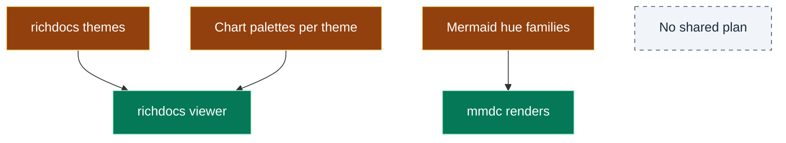

<details>
<summary>BEFORE detail: where colour decisions lived</summary>

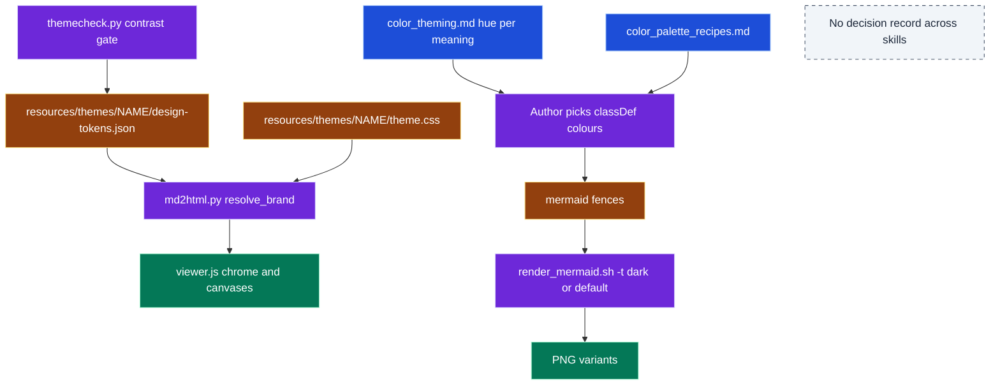

</details>

### AFTER (implemented, head `78ef9b1`)

One plan, one pipeline, many readers.

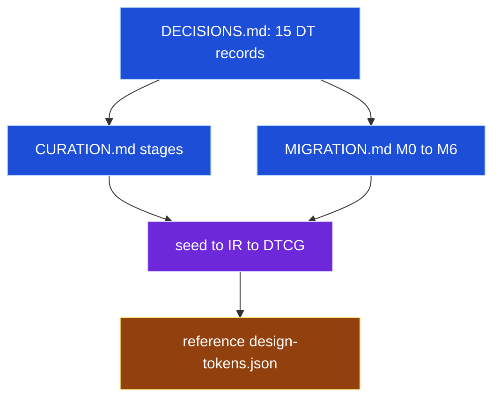

<details>
<summary>AFTER detail: which decision governs which part</summary>

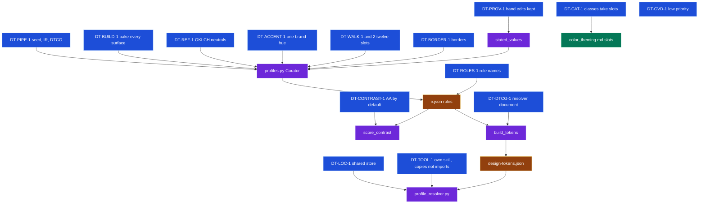

</details>

### Evidence

`docs/plans/refactor-design-tokens/README.md` at head, lines 14 to 20:

```text
  seed.json              ir.json                   design-tokens.json (DTCG)
  ─────────              ───────                   ────────────────────────
  OPTIONAL               the root artifact    ──▶   the ONLY file skills
  a few parameters  ──▶  semantically              read at runtime
  + one brand hue        complete: every
                         role, every surface,
                         light + dark
```

### Takeaway, validation, risks

- **Takeaway:** every later section cites a `DT-*` id, so a reviewer can check code against intent.
- **Validation:** `make docs-ci` reports 0 findings over the plan files.
- **Risk:** the plan stays in `docs/plans/` after it is done. It is marked implemented and points at the skill.
- **Reviewer decision:** pending.

## 2. One file format and one lookup

**Claim.** A profile is one DTCG 2025.10 resolver document, found by one five-tier lookup that every consumer copies.
**Motivation.** Consumers must agree on where a profile lives and how to read it, without importing each other's code (DT-TOOL-1).
**Prerequisites.** Section 1 (DT-LOC-1, DT-DTCG-1, DT-TOOL-1).

### Related files

- `skills/design-profiles/scripts/profile_resolver.py` (new, 208 lines): cascade, `.default-profile`, DTCG reader
- `skills/design-profiles/scripts/schemas/2025.10/resolver.json` (new): the DTCG resolver schema, vendored for a test
- `skills/design-profiles/scripts/test_profile_resolver.py` (new, 14 tests)

### BEFORE (base `7238ef5`)

There was no profile, so there was no lookup. Each consumer read its own files.

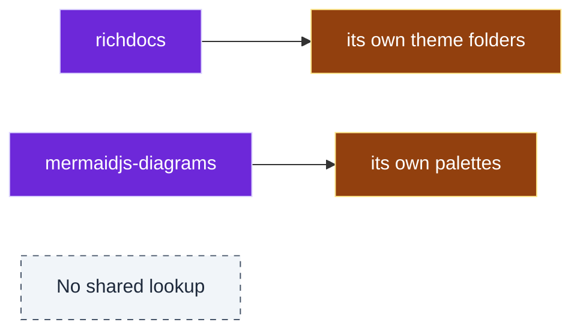

<details>
<summary>BEFORE detail: the two unrelated lookups</summary>

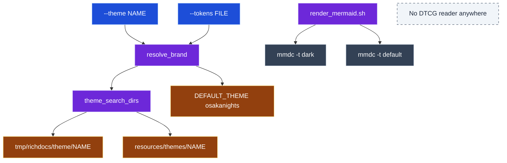

</details>

### AFTER (implemented, head `78ef9b1`)

A name, or the default file, walks five tiers. The first hit is read as flat tokens.

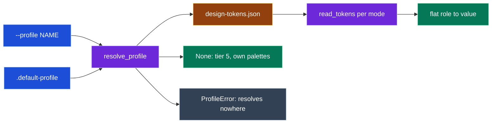

<details>
<summary>AFTER detail: the cascade and the reader</summary>

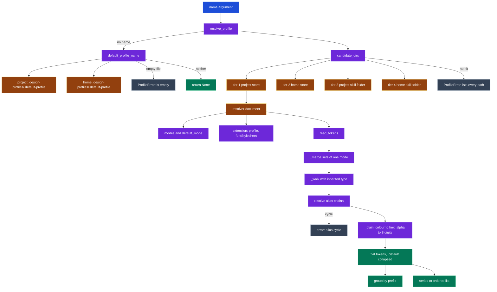

</details>

### Data model

The file a consumer reads changed shape. BEFORE is the richdocs brandpack, AFTER is the profile.

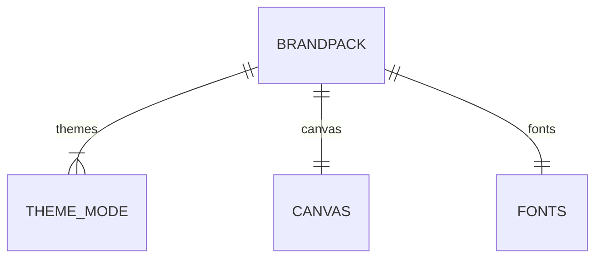

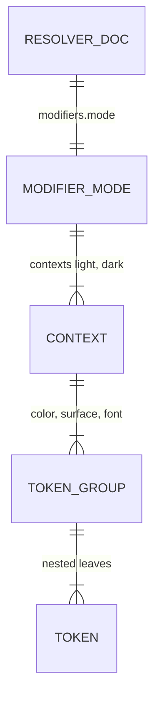

<details>
<summary>Data model detail: BEFORE brandpack keys and AFTER resolver fields</summary>

BEFORE, `resources/themes/osakanights/design-tokens.json` at base:

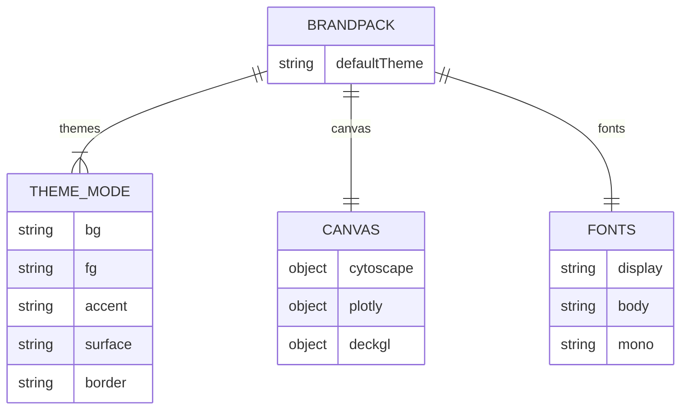

AFTER, `design-tokens.json` written by `build_tokens`:

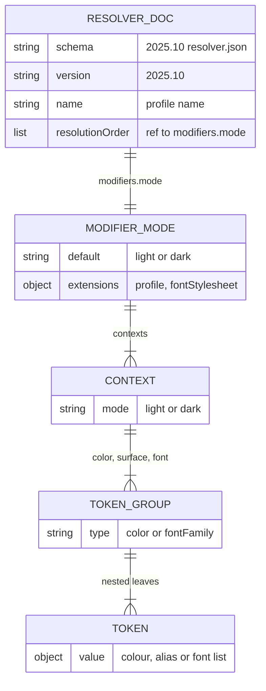

</details>

### Evidence

`skills/design-profiles/scripts/profile_resolver.py` at head, lines 70 to 98:

```python
def resolve_profile(
    name: str | None,
    skill: str,
    project: Path | None = None,
    home: Path | None = None,
) -> Path | None:
    # docstring omitted
    project = Path.cwd() if project is None else project
    home = Path.home() if home is None else home
    source = "--profile"
    if name is None:
        name = default_profile_name(project, home)
        if name is None:
            return None
        source = DEFAULT_FILE
    tried = candidate_dirs(name, skill, project, home)
    for folder in tried:
        if (folder / TOKENS_FILE).is_file():
            return folder / TOKENS_FILE
    listing = "\n".join(f"  {d / TOKENS_FILE}" for d in tried)
    raise ProfileError(
        f"error: design profile {name!r} (from {source}) resolves nowhere. Tried:\n{listing}"
    )
```

### Takeaway, validation, risks

- **Takeaway:** "no profile" and "a profile you asked for is missing" are different outcomes. The first is tier 5, the second fails loudly.
- **Validation:** `test_profile_resolver.py` covers the cascade order, the empty default file, alias cycles and missing modes, at 100% line coverage.
- **Risk:** `ProfileError` subclasses `SystemExit`, so library callers must not catch broad exceptions around it.
- **Reviewer decision:** pending.

## 3. Curation bakes every surface; build only serialises

**Claim.** `profiles.py` turns a few seed values into a complete IR covering every role and every surface, then writes the DTCG file with no design logic.
**Motivation.** Consumers should rename tokens, never compute colours (DT-BUILD-1). Contrast is checked once, at curation.
**Prerequisites.** Section 2 (the file format and `profile_resolver` reader).

### Related files

- `skills/design-profiles/scripts/profiles.py` (new, 1,564 lines): `Curator`, `score_contrast`, `curate_profile`, `build_tokens`, `build_lineage`, `generate`, CLI
- `skills/design-profiles/scripts/test_profiles.py` (new, 27 tests)

### BEFORE (base `7238ef5`)

Colours were authored by hand per theme, then checked after the fact.

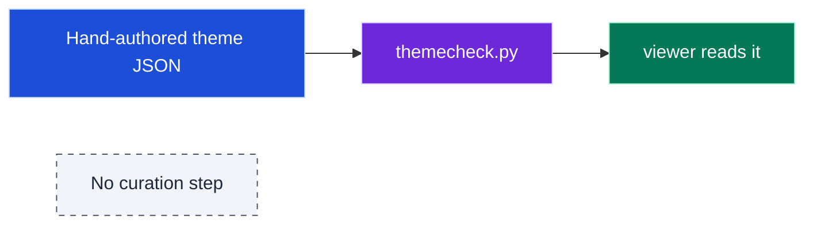

<details>
<summary>BEFORE detail: per-surface colour sources</summary>

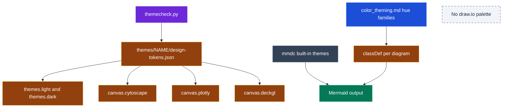

</details>

### AFTER (implemented, head `78ef9b1`)

Three artifacts, two transforms.

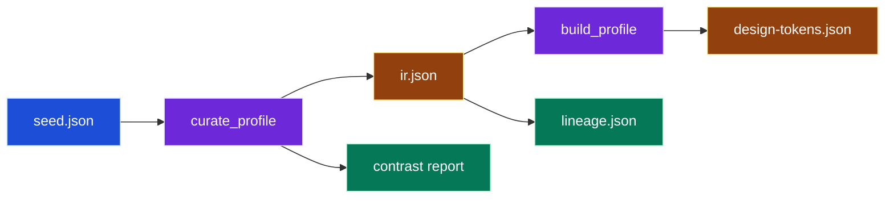

<details>
<summary>AFTER detail: Curator stages and build rules</summary>

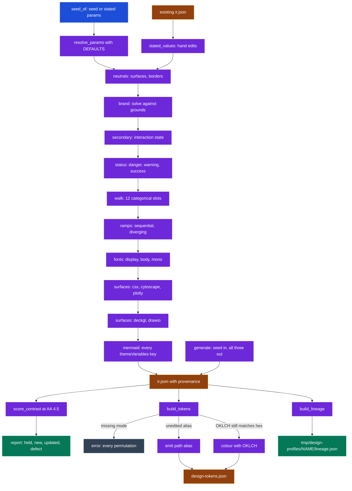

</details>

### Evidence

`skills/design-profiles/scripts/profiles.py` at head, lines 952 to 963:

```python
    def run(self) -> dict[str, Any]:
        self.neutrals()
        self.brand()
        self.secondary()
        self.status()
        self.walk()
        self.ramps()
        self.fonts()
        self.surfaces()
        params = {k: {"value": v, "source": s} for k, (v, s) in self.p.items()}
        return {"$extensions": {EXT: {"params": params}}, **self.ir}
```

Lines 375 to 390 (signature joined onto two lines): every derived colour is solved, not picked. The search walks lightness outward from an anchor until the test passes.

```python
    def solve(self, hue: float, cmax: float, anchor: float,
              test: Callable[[str], bool], what: str) -> LCH:
        """The lightness nearest `anchor` whose colour passes `test`, chroma capped at `cmax`."""
        for step in range(int(1 / STEP) + 1):
            for lightness in sorted({anchor + step * STEP, anchor - step * STEP}):
                if 0.0 <= lightness <= 1.0:
                    lch = (lightness, min(max_chroma(lightness, hue), cmax), hue)
                    if test(hex_of(lch)):
                        return lch
        raise SystemExit(f"error: unsolvable: {what} at hue {hue:.1f}")
```

Lines 1184 to 1189 (inside `build_tokens`): a stale OKLCH is dropped rather than shipped.

```python
                # A hand edit made since the last curate leaves the recorded OKLCH stale, so
                # it is used only when it still produces this exact hex.
                lch = ext.get("oklch", {}).get(m)
                if lch is not None and hex_of((lch[0], lch[1], lch[2])) != node[m]:
                    lch = None
                branch[leaf] = {"$value": dtcg_colour(node[m], lch)}
```

### Takeaway, validation, risks

- **Takeaway:** a consumer never decides a colour. If a surface looks wrong, the fix is a block in `Curator.surfaces()`.
- **Validation:** all six examples and a hue-only seed curate with 0 contrast defects; curating twice changes nothing; built output validates against the vendored schema; 99% line coverage.
- **Risk:** surface keys are flat IR names (`surface.css.page`), which is a judgement call flagged in the PR body.
- **Reviewer decision:** pending.

## 4. The design-profiles skill package

**Claim.** The producer ships as a normal skill: an operating manual, a maintainer guide, six example seeds, and the same quality gates as richdocs.
**Motivation.** Agents need a route to create and pick profiles; maintainers need a gate before handoff.
**Prerequisites.** Sections 2 and 3.

### Related files

- `skills/design-profiles/CLAUDE.md` (new): file map, invariants, how to change the resolver
- `skills/design-profiles/SKILL.md` (new): route by intent, commands, rules
- `skills/design-profiles/resources/examples/fernline/seed.json` (new)
- `skills/design-profiles/resources/examples/freshgreens/seed.json` (new)
- `skills/design-profiles/resources/examples/gandalf/seed.json` (new)
- `skills/design-profiles/resources/examples/locomotif/seed.json` (new)
- `skills/design-profiles/resources/examples/osakanights/seed.json` (new)
- `skills/design-profiles/resources/examples/v2ai/seed.json` (new)
- `skills/design-profiles/scripts/.gitignore` (new)
- `skills/design-profiles/scripts/Makefile` (new, mirrors richdocs: format, lint, mypy strict, tests)
- `skills/design-profiles/scripts/conftest.py` (new)

### BEFORE (base `7238ef5`)

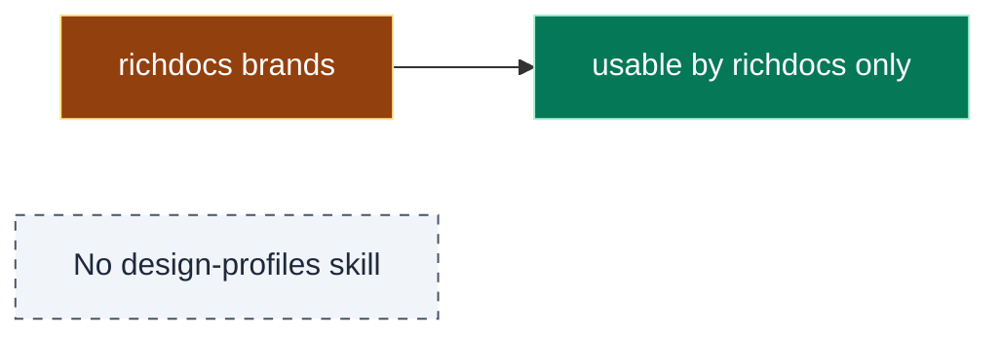

<details>
<summary>BEFORE detail: brands as richdocs-only themes</summary>

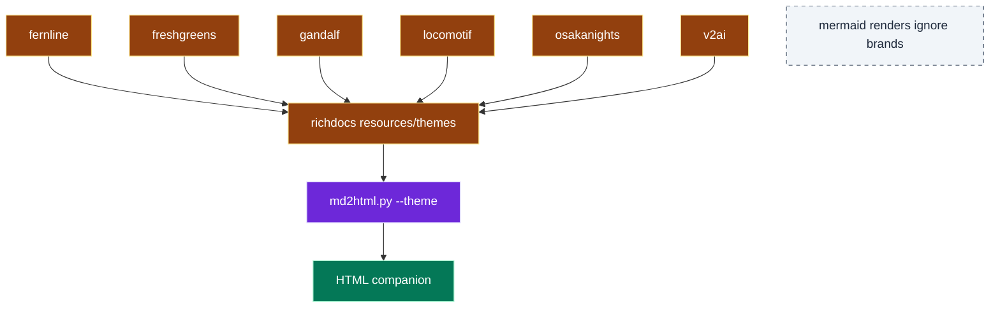

</details>

### AFTER (implemented, head `78ef9b1`)

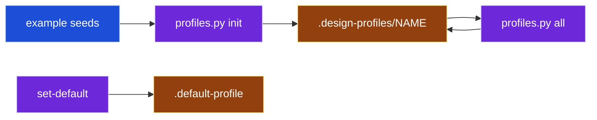

<details>
<summary>AFTER detail: CLI subcommands and gates</summary>

```mermaid
flowchart TB
  HUE["--hue H"]:::input --> INIT["init NAME"]:::process
  ACC["--accent HEX"]:::input --> INIT
  EXA["--example BRAND"]:::input --> INIT
  INIT --> SEED["seed.json"]:::storage
  SEED --> CUR["curate"]:::process
  CUR --> IR["ir.json"]:::storage
  IR --> BLD["build"]:::process
  BLD --> TOK["design-tokens.json"]:::storage
  ALL["all: curate then build"]:::process --> CUR
  IR --> LIN["lineage"]:::process
  STAT["status"]:::process --> TOK
  SD["set-default"]:::process --> DEF[".default-profile"]:::storage
  USER["--user: home store"]:::input --> INIT
  STO["--store DIR"]:::input --> INIT
  MK["Makefile ci"]:::process --> RUFF["ruff format and lint"]:::external
  MK --> MYPY["mypy strict"]:::external
  MK --> PYT["pytest with coverage floor 90"]:::external
  PYT --> JS["jsonschema at test time only"]:::external
  classDef input fill:#1d4ed8,stroke:#bfdbfe,color:#ffffff
  classDef process fill:#6d28d9,stroke:#ddd6fe,color:#ffffff
  classDef storage fill:#92400e,stroke:#fde68a,color:#ffffff
  classDef external fill:#334155,stroke:#cbd5e1,color:#ffffff
```

</details>

### Evidence

`skills/design-profiles/resources/examples/osakanights/seed.json` at head (font stylesheet URL shortened):

```json
{
  "brand.hue": 295.044,
  "brand.chroma": 0.131,
  "brand.lightness": 0.45,
  "brand.dark.hue": 295.159,
  "brand.dark.chroma": 0.109,
  "brand.dark.lightness": 0.801,
  "mode.default": "dark",
  "font.display": "'Fraunces', Georgia, serif",
  "font.body": "'Fira Sans', -apple-system, BlinkMacSystemFont, 'Segoe UI', Roboto, sans-serif",
  "font.mono": "'JetBrains Mono', ui-monospace, 'SF Mono', Menlo, Consolas, monospace",
  "font.stylesheet": "https://fonts.googleapis.com/css2?family=Fira+Sans..."
}
```

### Takeaway, validation, risks

- **Takeaway:** each richdocs brand now exists as a seed, so it can paint Mermaid output too.
- **Validation:** `make -C skills/design-profiles/scripts ci` is green.
- **Risk:** the seeds add four keys (`mode.default` and three `font.*`) that the plan's CURATION.md did not list at first. The PR body flags this.
- **Reviewer decision:** pending.

## 5. richdocs reads a profile first

**Claim.** `md2html.py` looks up a design profile before any theme, maps it onto its brandpack by renaming, and says which one it used.
**Motivation.** One profile should restyle the HTML companion with no new theme folder.
**Prerequisites.** Sections 2 and 3 (resolver copy and the `surface.*` tokens).

### Related files

- `skills/richdocs/CLAUDE.md`: file map adds `profile_resolver.py`
- `skills/richdocs/SKILL.md`: new intent row and the `--profile` option
- `skills/richdocs/resources/adr-log.md`: ADR-028
- `skills/richdocs/scripts/Makefile`: `COPIED_PY_SCRIPTS = profile_resolver`
- `skills/richdocs/scripts/conftest.py`: reloads the copied module
- `skills/richdocs/scripts/md2html.py`: `@@ -111,6 +118,146 @@` and three smaller hunks
- `skills/richdocs/scripts/profile_resolver.py` (new): byte-identical copy
- `skills/richdocs/scripts/test_md2html.py`: HOME isolation fixture and 7 profile tests
- `skills/richdocs/scripts/testdata/osakanights/design-tokens.json` (new): fixture profile

### BEFORE (base `7238ef5`)

```mermaid
flowchart LR
  TH["--theme"]:::input --> RB["resolve_brand"]:::process
  TK["--tokens"]:::input --> RB
  RB --> BP["brandpack"]:::storage
  BP --> HTML["HTML companion"]:::output
  classDef input fill:#1d4ed8,stroke:#bfdbfe,color:#ffffff
  classDef process fill:#6d28d9,stroke:#ddd6fe,color:#ffffff
  classDef storage fill:#92400e,stroke:#fde68a,color:#ffffff
  classDef output fill:#047857,stroke:#a7f3d0,color:#ffffff
```

<details>
<summary>BEFORE detail: theme resolution in main</summary>

```mermaid
flowchart TB
  MAIN["main"]:::process --> RB["resolve_brand"]:::process
  RB -->|--theme NAME| LT["load_theme NAME"]:::process
  RB -->|--tokens only| NONE["None: raw brandpack"]:::process
  RB -->|neither| LD["load_theme DEFAULT_THEME"]:::process
  LT --> SD["theme_search_dirs"]:::process
  LD --> SD
  SD --> PT["tmp/richdocs/theme"]:::storage
  SD --> BT["resources/themes"]:::storage
  PT --> THM["Theme name, tokens_path, css"]:::output
  BT --> THM
  NONE --> TP["tokens path"]:::storage
  THM --> PRN["print theme: NAME"]:::output
  classDef process fill:#6d28d9,stroke:#ddd6fe,color:#ffffff
  classDef storage fill:#92400e,stroke:#fde68a,color:#ffffff
  classDef output fill:#047857,stroke:#a7f3d0,color:#ffffff
```

</details>

### AFTER (implemented, head `78ef9b1`)

```mermaid
flowchart LR
  PR["--profile or .default-profile"]:::input --> RPT["resolve_profile_theme"]:::process
  RPT -->|found| LP["load_profile"]:::process
  RPT -->|none| RB["resolve_brand as before"]:::process
  LP --> BP["brandpack"]:::storage
  RB --> BP
  BP --> HTML["HTML companion"]:::output
  classDef input fill:#1d4ed8,stroke:#bfdbfe,color:#ffffff
  classDef process fill:#6d28d9,stroke:#ddd6fe,color:#ffffff
  classDef storage fill:#92400e,stroke:#fde68a,color:#ffffff
  classDef output fill:#047857,stroke:#a7f3d0,color:#ffffff
```

<details>
<summary>AFTER detail: precedence and the rename map</summary>

```mermaid
flowchart TB
  MAIN["main"]:::process --> RPT["resolve_profile_theme"]:::process
  RPT -->|--profile given| RES["profile_resolver.resolve_profile"]:::process
  RPT -->|--theme or --tokens, no --profile| SKIP["None: user chose a theme"]:::process
  RPT -->|nothing given| RES
  RES -->|not found| ERR["ProfileError, exit"]:::external
  RES -->|tier 5| SKIP
  RES -->|path| LP["load_profile"]:::process
  LP --> BFP["brandpack_from_profile"]:::process
  BFP --> CSS["surface.css to themes"]:::storage
  BFP --> CY["surface.cytoscape to canvas"]:::storage
  BFP --> PL["surface.plotly series to canvas"]:::storage
  BFP --> DG["surface.deckgl to canvas"]:::storage
  BFP --> FT["font.family to fonts"]:::storage
  BFP --> STS["color.text status to status"]:::storage
  LP --> PCSS["profile_css: web font import"]:::process
  LP --> OUT["tmp/richdocs/profile/NAME/design-tokens.json"]:::storage
  OUT --> THM["Theme kind profile"]:::output
  SKIP --> RB["resolve_brand"]:::process
  RB --> THM2["Theme kind theme"]:::output
  THM --> P1["print profile: NAME"]:::output
  THM2 --> P2["print theme: NAME, no design profile"]:::output
  classDef process fill:#6d28d9,stroke:#ddd6fe,color:#ffffff
  classDef storage fill:#92400e,stroke:#fde68a,color:#ffffff
  classDef output fill:#047857,stroke:#a7f3d0,color:#ffffff
  classDef external fill:#334155,stroke:#cbd5e1,color:#ffffff
```

</details>

### Evidence

`skills/richdocs/scripts/md2html.py`, hunk `@@ -532,9 +688,11 @@`:

```diff
-    # A named theme brings its own brandpack + CSS. With neither --theme nor an
-    # explicit --tokens, this defaults to DEFAULT_THEME (ADR-018).
-    theme = resolve_brand(args.theme, args.tokens)
+    # A design profile is looked up first. Without one, a named theme brings its own
+    # brandpack + CSS, and with neither --theme nor --tokens this defaults to
+    # DEFAULT_THEME (ADR-018).
+    profile = resolve_profile_theme(args.profile, args.theme, args.tokens)
+    theme = profile or resolve_brand(args.theme, args.tokens)
```

Hunk `@@ -111,6 +118,146 @@`, the precedence rule (docstring omitted):

```python
def resolve_profile_theme(profile_arg, theme_arg, tokens_arg, *, project=None,
                          home=None, out_root=PROJECT_PROFILES_DIR) -> Theme | None:
    if profile_arg is None and (theme_arg or tokens_arg is not None):
        return None
    path = profile_resolver.resolve_profile(profile_arg, PROFILE_SKILL, project, home)
    return load_profile(path, out_root) if path else None
```

Same hunk, part of the rename map. Categories go into the one chart palette, `series`:

```python
        plotly[mode] = {
            "paper": pl["paper_bgcolor"],
            "plot": pl["plot_bgcolor"],
            "font": pl["font_color"],
            "grid": pl["gridcolor"],
            "series": ramp("colorway"),
            # ... muted, sequential, diverging omitted
        }
```

### Takeaway, validation, risks

- **Takeaway:** an explicit `--theme` still wins over a default profile. Only `--profile` beats `--theme`.
- **Validation:** `test_brandpack_from_profile_covers_every_key_a_built_in_theme_has` and `test_resolve_profile_theme_precedence` pass; richdocs `make ci` is green.
- **Risk:** the plan's step M4 named `categoryColours`, which ADR-023 retired. Categories use `series` instead. Worth a reviewer's look.
- **Risk:** not opened in a browser with a profile applied.
- **Reviewer decision:** pending.

## 6. mermaidjs-diagrams reads a profile first

**Claim.** A TypeScript port of the resolver hands `mmdc` a full `themeVariables` config per mode, and the docs now give categories numbered slots instead of hues by meaning.
**Motivation.** Diagrams rendered with `mmdc` should match the brand without a `classDef` per node.
**Prerequisites.** Sections 2 and 3 (`surface.mermaid` tokens).

### Related files

- `skills/mermaidjs-diagrams/SKILL.md`: profile-first rendering and lint flags
- `skills/mermaidjs-diagrams/resources/color_palette_recipes.md`: note on profile slots
- `skills/mermaidjs-diagrams/resources/color_theming.md`: new section 0; hue families become slots
- `skills/mermaidjs-diagrams/scripts/CLAUDE.md`: script table and ADR-008
- `skills/mermaidjs-diagrams/scripts/Makefile`: `TS_SCRIPTS = color_contrast design_profile`
- `skills/mermaidjs-diagrams/scripts/design_profile.test.ts` (new)
- `skills/mermaidjs-diagrams/scripts/design_profile.ts` (new, 243 lines)
- `skills/mermaidjs-diagrams/scripts/render_mermaid.sh`: `--design-profile`, config files, `-c` to `mmdc`
- `skills/mermaidjs-diagrams/scripts/render_mermaid.test.ts`: 2 new tests
- `skills/mermaidjs-diagrams/scripts/testdata/osakanights/design-tokens.json` (new): fixture profile
- `skills/richdocs/vendor/mermaidjs-diagrams/` (11 paths): the same changes, re-vendored per richdocs ADR-007. `SKILL.md` becomes `mermaidjs-diagrams.md`, and the vendored `scripts/CLAUDE.md` also picks up older reference renames the last vendor run had missed.

### BEFORE (base `7238ef5`)

```mermaid
flowchart LR
  MD["diagram.md"]:::input --> RS["render_mermaid.sh"]:::process
  RS --> D["mmdc -t dark"]:::external
  RS --> L["mmdc -t default"]:::external
  D --> PNG["two PNGs"]:::output
  L --> PNG
  classDef input fill:#1d4ed8,stroke:#bfdbfe,color:#ffffff
  classDef process fill:#6d28d9,stroke:#ddd6fe,color:#ffffff
  classDef output fill:#047857,stroke:#a7f3d0,color:#ffffff
  classDef external fill:#334155,stroke:#cbd5e1,color:#ffffff
```

<details>
<summary>BEFORE detail: render variants and colour guidance</summary>

```mermaid
flowchart TB
  ARG["file.md list"]:::input --> CASE["mode switch: doctor, classify, verify"]:::process
  CASE --> LOOP["for each INPUT"]:::process
  LOOP --> RVD["render_variant dark transparent"]:::process
  LOOP --> RVL["render_variant default white"]:::process
  RVD --> RM["run_mmdc -t theme -b bgcolor"]:::process
  RVL --> RM
  RM --> NPX["npx mermaid-cli mmdc"]:::external
  NPX --> VER["verify_output_dir"]:::process
  VER --> PNG["PNG files"]:::output
  CT["color_theming.md: hue per meaning"]:::input --> CD["classDef in each fence"]:::input
  CD --> ARG
  LINT["mermaidjs-lint fixed canvas flags"]:::external
  classDef input fill:#1d4ed8,stroke:#bfdbfe,color:#ffffff
  classDef process fill:#6d28d9,stroke:#ddd6fe,color:#ffffff
  classDef output fill:#047857,stroke:#a7f3d0,color:#ffffff
  classDef external fill:#334155,stroke:#cbd5e1,color:#ffffff
```

</details>

### AFTER (implemented, head `78ef9b1`)

```mermaid
flowchart LR
  MD["diagram.md"]:::input --> RS["render_mermaid.sh"]:::process
  RS --> DP["design_profile.ts mermaid-config"]:::process
  DP --> CFG["light and dark config JSON"]:::storage
  CFG --> MMDC["mmdc -t base -c config"]:::external
  MMDC --> PNG["two on-brand PNGs"]:::output
  RS -->|no profile| OLD["mmdc themes as before"]:::external
  classDef input fill:#1d4ed8,stroke:#bfdbfe,color:#ffffff
  classDef process fill:#6d28d9,stroke:#ddd6fe,color:#ffffff
  classDef output fill:#047857,stroke:#a7f3d0,color:#ffffff
  classDef storage fill:#92400e,stroke:#fde68a,color:#ffffff
  classDef external fill:#334155,stroke:#cbd5e1,color:#ffffff
```

<details>
<summary>AFTER detail: the shell flow and the TypeScript port</summary>

```mermaid
flowchart TB
  FLAG["--design-profile NAME"]:::input --> SH["render_mermaid.sh"]:::process
  DFF[".default-profile in project or home"]:::input --> SH
  SH -->|flag without name| E1["error: needs a profile name"]:::external
  SH --> MAIN["design_profile.ts main"]:::process
  MAIN --> RP["resolveProfile"]:::process
  RP -->|resolves nowhere| E2["exit 1 before any browser"]:::external
  RP --> LOAD["loadProfile"]:::process
  LOAD --> MC["mermaidConfig per mode"]:::process
  MC --> RT["readTokens"]:::process
  RT --> GRP["group surface.mermaid"]:::process
  GRP --> TV["themeVariables plus darkMode, fontFamily"]:::storage
  TV --> CL["MERMAID_RUNTIME_DIR design-profile-light.json"]:::storage
  TV --> CDK["MERMAID_RUNTIME_DIR design-profile-dark.json"]:::storage
  CDK --> RVD["render_variant dark transparent"]:::process
  CL --> RVL["render_variant default white"]:::process
  RVD --> RM["run_mmdc: theme base, -c config"]:::process
  RVL --> RM
  RM --> NPX["npx mermaid-cli mmdc"]:::external
  NPX --> PNG["PNG files"]:::output
  MAIN --> LF["lintFlags"]:::process
  LF --> LINT["mermaidjs-lint canvas flags"]:::external
  MAIN --> ST["status: which profile applies"]:::output
  SLOTS["color_theming.md: categorical slots"]:::input
  classDef input fill:#1d4ed8,stroke:#bfdbfe,color:#ffffff
  classDef process fill:#6d28d9,stroke:#ddd6fe,color:#ffffff
  classDef output fill:#047857,stroke:#a7f3d0,color:#ffffff
  classDef storage fill:#92400e,stroke:#fde68a,color:#ffffff
  classDef external fill:#334155,stroke:#cbd5e1,color:#ffffff
```

</details>

### Evidence

`skills/mermaidjs-diagrams/scripts/render_mermaid.sh`, hunk `@@ -180,17 +186,23 @@`:

```diff
 run_mmdc() {
-  local input="$1" output_target="$2" output="$3" theme="$4" bgcolor="$5" fmt="$6"
+  local input="$1" output_target="$2" output="$3" theme="$4" bgcolor="$5" fmt="$6" config="${7:-}"
+  local -a profile=()
+  # A design profile's config carries every themeVariables key on the base theme.
+  if [ -n "$config" ]; then
+    theme=base
+    profile=(-c "$config")
+  fi
   npx -p @mermaid-js/mermaid-cli mmdc \
     -i "${input}" \
     -a "${output_target}" \
     -o "${output}" \
-    --scale 4 -e "${fmt}" -t "${theme}" -b "${bgcolor}"
+    --scale 4 -e "${fmt}" -t "${theme}" -b "${bgcolor}" ${profile[@]+"${profile[@]}"}
 }
```

`skills/mermaidjs-diagrams/scripts/design_profile.ts` at head, lines 173 to 179:

```typescript
export const mermaidConfig = (doc: ProfileDoc, mode: string): MermaidConfig => {
  const flat = readTokens(doc, mode);
  const themeVariables: Flat = { ...group(flat, "surface.mermaid"), darkMode: mode === "dark" };
  const font = flat["font.family.body"];
  if (typeof font === "string") themeVariables.fontFamily = font;
  return { theme: "base", themeVariables };
};
```

`skills/mermaidjs-diagrams/resources/color_theming.md`, hunk `@@ -69,21 +89,26 @@`:

```diff
-Assign each **category** (input, process, output, storage, external) a distinct
-**hue family**. Within each family, vary saturation and lightness to encode
-**prominence** (primary vs. secondary vs. background):
+Give each **category** of the diagram (Storage, Compute, Input, Process, any
+class at all) the **next slot** in the order the categories first appear. A slot
+is a hue family; it carries no meaning, it only keeps categories visually apart.
```

### Takeaway, validation, risks

- **Takeaway:** the published lint was not changed. `design_profile.ts lint-flags` only feeds it the profile's backgrounds.
- **Validation:** mermaid `make ci` is green; a real `mmdc` render with the osakanights profile was checked by eye.
- **Risk:** the vendored copy must be re-vendored on every upstream change. Section 7's test catches the fixture drifting.
- **Reviewer decision:** pending.

## 7. Packaging and the drift guard

**Claim.** The new skill ships in `jpai-essentials`, and one repository test holds every copy of the resolver and fixture to the producer.
**Motivation.** Copies are the price of skill independence (DT-TOOL-1). A test makes that price visible.
**Prerequisites.** Sections 4 to 6.

### Related files

- `README.md`: skill table, counts, and a diagram node for design-profiles
- `plugins/README.md`: skill count
- `plugins/composition.yaml`: `design-profiles` added to `jpai-essentials`
- `plugins/jpai-essentials/.claude-plugin/plugin.json`: description names design-profiles
- `plugins/jpai-essentials/.codex-plugin/plugin.json`: same description
- `plugins/jpai-essentials/skills/` (46 paths): generated by `uv run scripts/sync_plugins.py`, never edited by hand. Each mirrors a source path from sections 2 to 6.
- `tests/test_design_profile_copies.py` (new, 12 tests)

### BEFORE (base `7238ef5`)

```mermaid
flowchart LR
  COMP["composition.yaml"]:::input --> SYNC["sync_plugins.py"]:::process
  SYNC --> PLUG["jpai-essentials, 6 skills"]:::output
  NOGUARD["No cross-skill copy test"]:::absent
  classDef input fill:#1d4ed8,stroke:#bfdbfe,color:#ffffff
  classDef process fill:#6d28d9,stroke:#ddd6fe,color:#ffffff
  classDef output fill:#047857,stroke:#a7f3d0,color:#ffffff
  classDef absent fill:#f1f5f9,stroke:#475569,color:#1e293b,stroke-dasharray:5 5
```

<details>
<summary>BEFORE detail: plugin build and checks</summary>

```mermaid
flowchart TB
  COMP["composition.yaml"]:::input --> SYNC["scripts/sync_plugins.py"]:::process
  SKILLS["skills/*"]:::storage --> SYNC
  SYNC --> MIR["plugins/jpai-essentials/skills"]:::output
  SYNC --> CPJ["claude-plugin manifest"]:::output
  SYNC --> XPJ["codex-plugin manifest"]:::output
  CI["make ci"]:::process --> SYNC
  CI --> VAL["validate invariants"]:::process
  CI --> PY["repo pytest"]:::process
  CI --> GATES["per-skill gates"]:::process
  NOCOPY["No resolver copies to guard"]:::absent
  classDef input fill:#1d4ed8,stroke:#bfdbfe,color:#ffffff
  classDef process fill:#6d28d9,stroke:#ddd6fe,color:#ffffff
  classDef output fill:#047857,stroke:#a7f3d0,color:#ffffff
  classDef storage fill:#92400e,stroke:#fde68a,color:#ffffff
  classDef absent fill:#f1f5f9,stroke:#475569,color:#1e293b,stroke-dasharray:5 5
```

</details>

### AFTER (implemented, head `78ef9b1`)

```mermaid
flowchart LR
  COMP["composition.yaml + design-profiles"]:::input --> SYNC["sync_plugins.py"]:::process
  SYNC --> PLUG["jpai-essentials, 7 skills"]:::output
  CANON["canonical resolver"]:::storage --> GUARD["test_design_profile_copies"]:::process
  GUARD --> COPIES["copies and fixtures"]:::storage
  classDef input fill:#1d4ed8,stroke:#bfdbfe,color:#ffffff
  classDef process fill:#6d28d9,stroke:#ddd6fe,color:#ffffff
  classDef output fill:#047857,stroke:#a7f3d0,color:#ffffff
  classDef storage fill:#92400e,stroke:#fde68a,color:#ffffff
```

<details>
<summary>AFTER detail: what the drift guard compares</summary>

```mermaid
flowchart TB
  CANON["design-profiles profile_resolver.py"]:::storage --> T1["copies are byte-identical"]:::process
  T1 --> RDC["richdocs profile_resolver.py"]:::storage
  SEED["examples osakanights seed.json"]:::input --> BUILT["fresh curate and build"]:::process
  BUILT --> T2["fixtures equal today's build"]:::process
  T2 --> F1["richdocs testdata fixture"]:::storage
  T2 --> F2["mermaidjs-diagrams testdata fixture"]:::storage
  T2 --> F3["vendored testdata fixture"]:::storage
  BUILT --> T3["TS port reads what Python reads"]:::process
  T3 --> TS["bun run design_profile.ts mermaid-config"]:::external
  T3 --> PYR["profile_resolver.read_tokens"]:::process
  ALLSEEDS["all six seeds"]:::input --> T4["seeds state each brand's accents"]:::process
  T4 --> BRANDS["richdocs themes accent hex"]:::storage
  COMP["composition.yaml"]:::input --> SYNC["sync_plugins.py"]:::process
  SYNC --> MIR["plugin mirror, 46 paths"]:::output
  CI["make ci"]:::process --> SYNC
  CI --> T1
  classDef input fill:#1d4ed8,stroke:#bfdbfe,color:#ffffff
  classDef process fill:#6d28d9,stroke:#ddd6fe,color:#ffffff
  classDef output fill:#047857,stroke:#a7f3d0,color:#ffffff
  classDef storage fill:#92400e,stroke:#fde68a,color:#ffffff
  classDef external fill:#334155,stroke:#cbd5e1,color:#ffffff
```

</details>

### Evidence

`plugins/composition.yaml`, hunk `@@ -20,6 +20,7 @@`:

```diff
     skills:
       - agnostic             # de-brand docs to generic placeholders
       - concise-decisions    # consolidate ambiguities into one briefed question
+      - design-profiles      # curate one brand profile that paints every surface
       - gooddocs             # audit, write and restructure documentation
```

`tests/test_design_profile_copies.py` at head, lines 64 to 79 (keyword arguments joined onto one line):

```python
@pytest.mark.parametrize("mode", ["light", "dark"])
def test_the_typescript_port_reads_what_python_reads(mode: str, built: Path, tmp_path: Path) -> None:
    store = tmp_path / ".design-profiles/osakanights"
    store.mkdir(parents=True)
    shutil.copy(built, store / "design-tokens.json")
    run = subprocess.run(
        ["bun", "run", str(TS_PORT), "mermaid-config", "--design-profile", "osakanights", "--mode", mode],
        cwd=tmp_path, capture_output=True, text=True, check=True,
    )
    variables = json.loads(run.stdout)["themeVariables"]
    flat = profile_resolver.read_tokens(json.loads(built.read_text(encoding="utf-8")), mode)
    expected = profile_resolver.group(flat, "surface.mermaid")
    assert {k: v for k, v in variables.items() if k not in ("darkMode", "fontFamily")} == expected
```

### Takeaway, validation, risks

- **Takeaway:** a resolver change has one recipe (`skills/design-profiles/CLAUDE.md`), and the test fails until every copy follows it.
- **Validation:** root `make ci` exits 0 after the merge of `main` (sync, 64 invariants, 164 tests, every skill gate).
- **Risk:** the plugin version stays `0.10.2`, the number `main` gave a librarian fix. A new skill may deserve `0.11.0`.
- **Reviewer decision:** pending.
