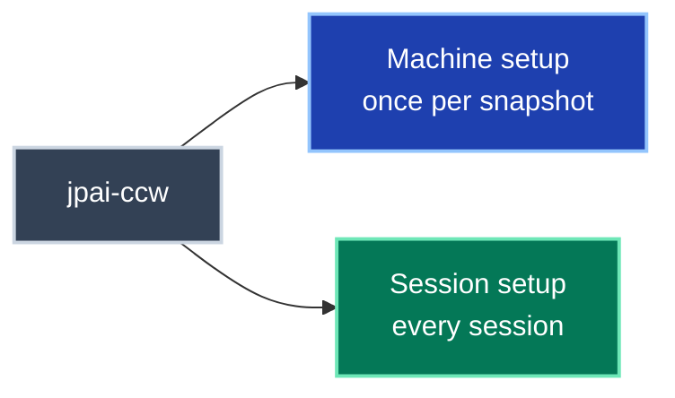
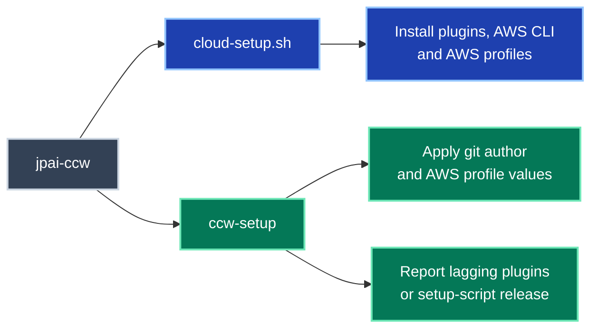

# jpai-ccw

Setup for Claude Code cloud sessions, also called Claude Cloud Workers.
This plugin ships one skill, its setup scripts and no hook.

## Overview

The environment's setup script prepares the machine; the skill finishes each session.

Skill, scripts and their results

The setup script is downloaded from a `ccw/vX.Y.Z` release tag, so each environment pins the version it runs.

## Included skills

| Skill | Purpose |
|---|---|
| [ccw-setup](skills/ccw-setup/README.md) | Check and apply a cloud session's per-session setup, and report lagging releases. |

## Use and maintenance

Follow the [installation guide](../../README.md#installing) for your agent.
See [plugin maintenance](../README.md#editing) for composition, manifests and generated skill copies.
See [releases](skills/ccw-setup/resources/cloud-setup.md#releases) for tagging the setup script.
