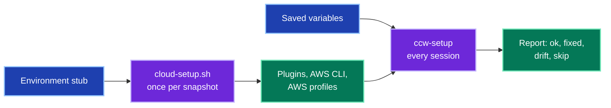
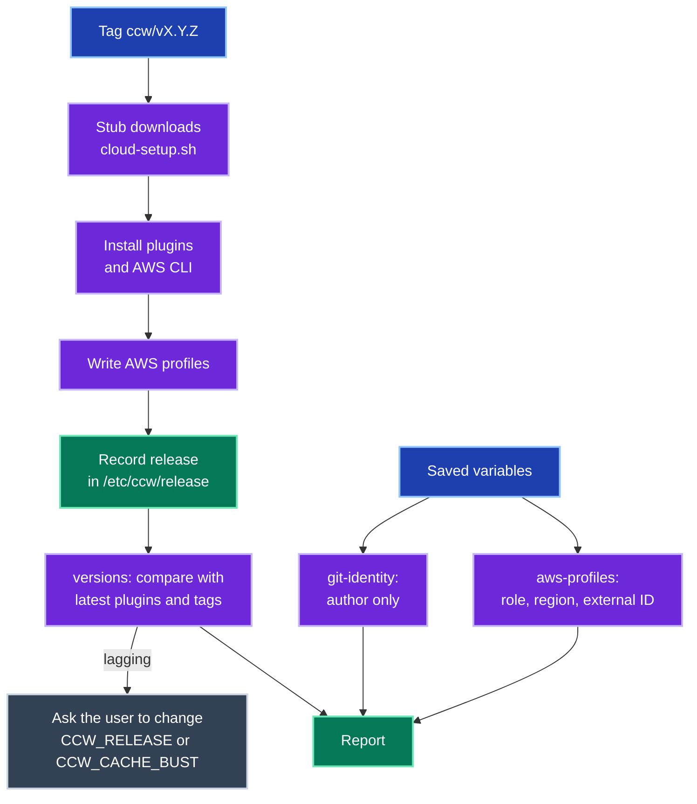

# ccw-setup

Set up a Claude Code cloud session, also called a Claude Cloud Worker.
The environment's setup script prepares the machine once per cached snapshot.
This skill applies what only the running session can, and reports what changed.

## Use it

```text
/ccw-setup          check and apply everything
/ccw-setup check    report drift, change nothing
```

- `git-identity` sets the commit author from saved variables and leaves the signing committer alone.
- `aws-profiles` writes the session's AWS profiles, including an admin profile's external ID.
- `versions` reports when the installed plugins or the pinned setup-script release lag the latest.

Rerunning on a session already in order changes nothing.

## Machine, then session



The setup script cannot read saved variables, so the session finishes what it starts.

<details>
<summary>Complete flow, including the release check</summary>



</details>

## Requirements and boundaries

- `uv` runs the check script; `git`, `curl` and the AWS CLI are called when present.
- The skill never edits the cloud environment; it names the change and the user approves it.
- Secret values, such as the external ID, are written but never printed.

## Reference

- [Operating instructions](SKILL.md)
- [Events, environments and releases](resources/cloud-setup.md)
- [Setup script stub](scripts/cloud-setup-stub.sh)
