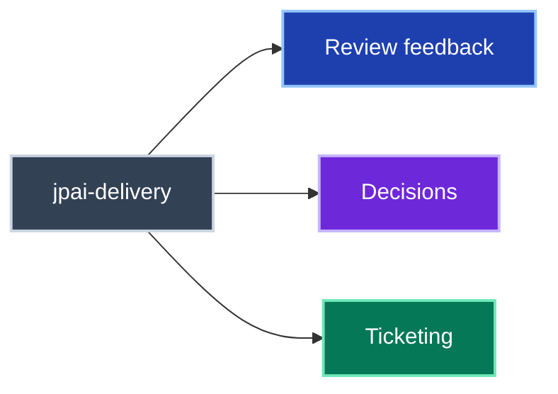
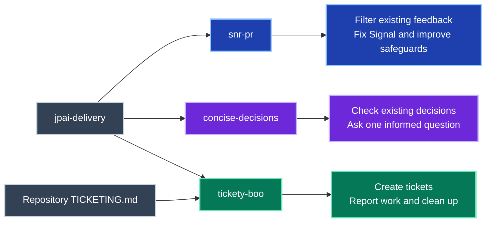

# jpai-delivery

Review feedback, decisions and ticketing in one plugin.
This plugin ships three skills and no hook.

## Overview

Choose a skill for the current task; review feedback, decisions and ticketing can be handled independently.

Skills and their results

Each skill follows its own contract; ticketing conventions come from the repository being worked on.

## Included skills

| Skill | Purpose |
|---|---|
| [snr-pr](skills/snr-pr/README.md) | Filter existing review feedback into Signal and Noise, then improve fixes and review filters. |
| [concise-decisions](skills/concise-decisions/README.md) | Check existing decisions and resolve related ambiguities with one informed question. |
| [tickety-boo](skills/tickety-boo/README.md) | Follow repository conventions for tickets, work in progress and cleanup. |

All three skills are also included in [jpai-essentials](../jpai-essentials/README.md).

## Use and maintenance

Follow the [installation guide](../../README.md#installing) for your agent.
See [plugin maintenance](../README.md#editing) for composition, manifests and generated skill copies.
