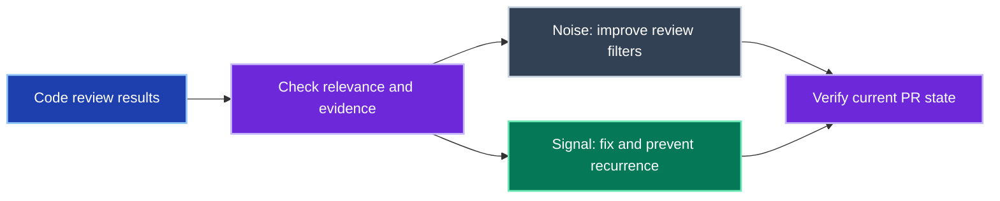

# snr-pr

Filter existing code review feedback into **Signal** and **Noise** to improve a pull request's signal-to-noise ratio.
Signal earns a fix and a safeguard against the problem category recurring.
Noise earns a better filter for future reviews.
Code review itself is a separate skill.

## Use it

```text
$snr-pr triage review feedback on the current branch
$snr-pr triage review feedback on PR 42
```

Name a PR when the branch is ambiguous.
The skill checks the repository, current head and every discussion page before acting within the user's authorization.
Every agent-authored discussion-thread reply starts with `Agent:`, including replies posted through `gh` using a user's account.

## Feedback loop



Both outcomes create a reusable lesson about how to spend attention.

```mermaid
flowchart LR
    P["Select and verify PR"]:::input --> F["Read every review thread"]:::input
    F --> E["Compare claim with base, head and conventions"]:::process
    E --> C{"Signal or Noise?"}:::process
    C -->|Noise| N["Identify distraction category"]:::rule
    N --> R["Strengthen review instructions"]:::rule
    C -->|Signal| D["Reproduce demonstrated problem"]:::process
    D --> X["Fix and strengthen durable safeguard"]:::output
    X --> T["Validate behavior and prevention"]:::process
    R --> U["Reply and resolve when authorized"]:::output
    T --> U
    U --> B["Update PR body and evidence"]:::process
    B --> V["Refresh head, threads and CI"]:::process
    V --> O["Report outcomes and blockers"]:::output
    classDef input fill:#1e40af,stroke:#93c5fd,color:#fff,stroke-width:2px
    classDef process fill:#6d28d9,stroke:#c4b5fd,color:#fff,stroke-width:2px
    classDef output fill:#047857,stroke:#6ee7b7,color:#fff,stroke-width:2px
    classDef rule fill:#334155,stroke:#cbd5e1,color:#fff,stroke-width:2px
```

<details>
<summary>Complete feedback triage workflow</summary>



</details>

## Boundaries

- Feedback must establish a concrete issue within the PR's intent to qualify as Signal.
- Unclear claims receive a bounded evidence check; material uncertainty remains visible.
- Product defects use behavioral regression tests; documentation and infrastructure use their applicable checks.
- Resolution follows validation; blocked fixes remain open with the blocker stated.
- Merging the PR, changing review settings and continuous monitoring require separate authorization.

## Reference

- [Operating instructions](SKILL.md)
- [Signal rubric](resources/signal.md)
- [Noise rubric](resources/noise.md)
