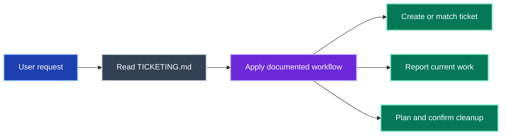
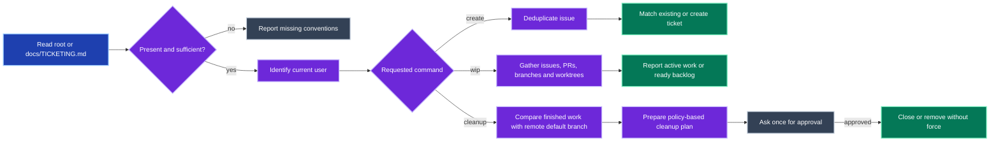

# tickety-boo

Handle tickets, work in progress and finished-work cleanup using the repository's own `TICKETING.md`.
The repository supplies the system, commands, naming rules and completion policy.
The skill identifies missing conventions rather than inventing them.

## Use it

```text
/tickety-boo create <issue description>
/tickety-boo wip
/tickety-boo cleanup
```

- `create` checks for duplicates before filing.
- `wip` gathers the current user's issues, PRs, branches and worktrees, then considers backlog work when none is active.
- `cleanup` prepares a plan and asks once before closing tickets or removing branches and worktrees.

## Repository-led workflow



Every route uses local conventions and the documented current-user identity.

<details>
<summary>Complete routing and stopping conditions</summary>



</details>

## Requirements and boundaries

- A root `TICKETING.md` or `docs/TICKETING.md` is required.
- Conflicting identity sources stop the workflow until resolved.
- A missing documented step is reported before dependent work proceeds.
- Cleanup uses the remote default branch as evidence and never forces removal.

## Reference

- [Operating instructions](SKILL.md)
- [Ticketing convention checklist](resources/TICKETING-guidelines.md)
