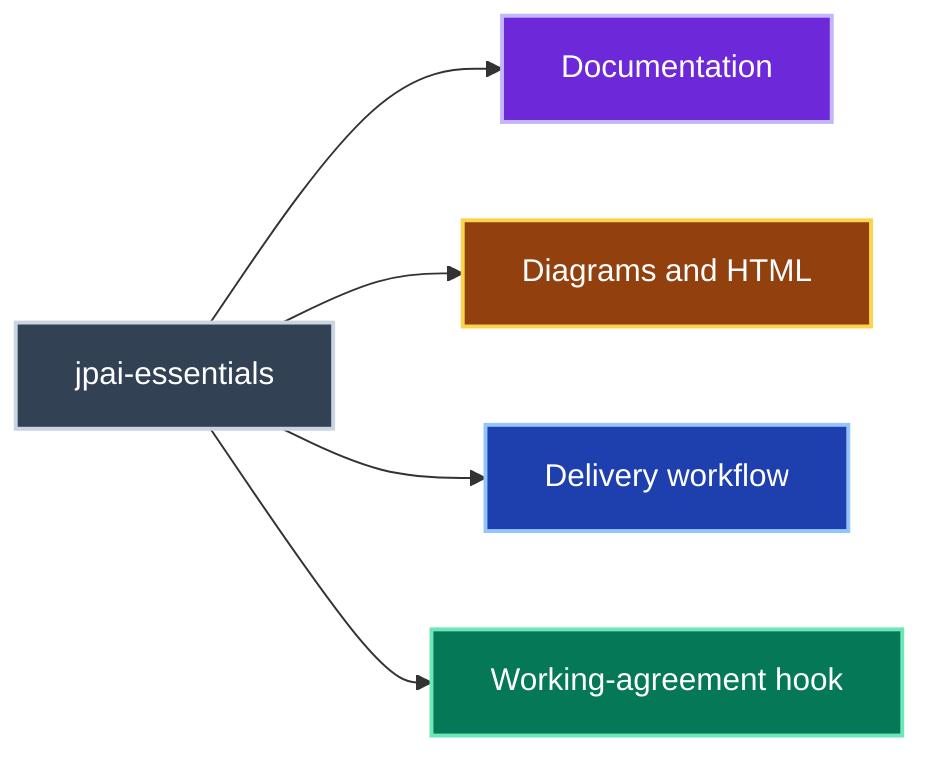
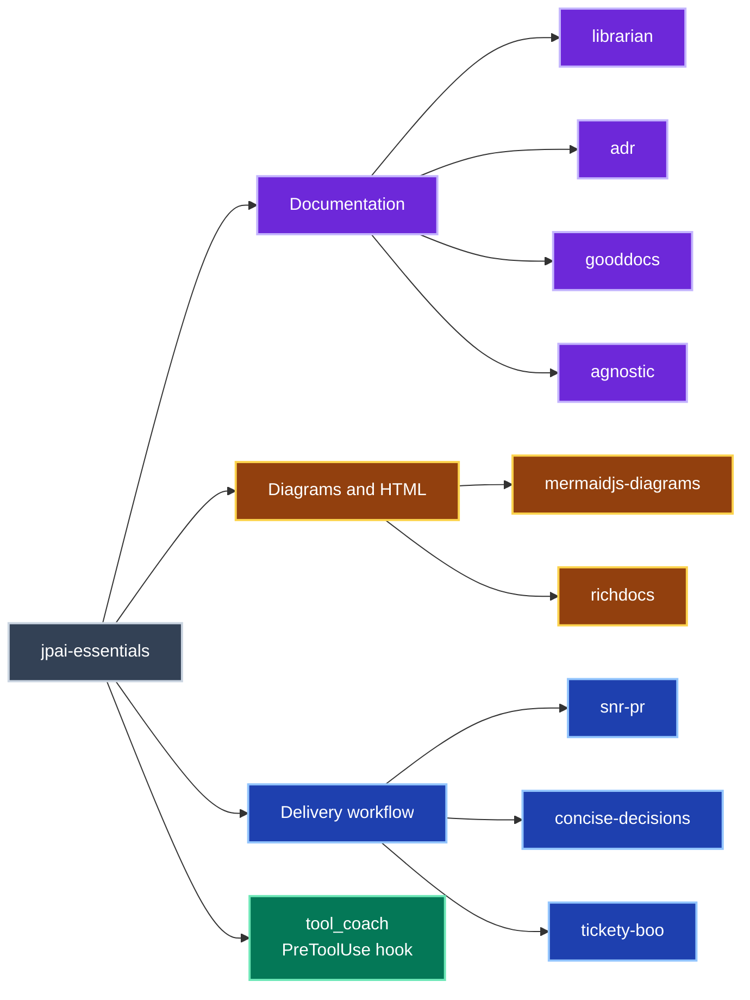

# jpai-essentials

Documentation, diagrams, review feedback, decisions and ticketing in one plugin.
Includes the `tool_coach` PreToolUse hook for working-agreement checks and corrective guidance.

## Overview

Choose the skill that fits the task; these groups describe capabilities rather than a required sequence.

Included skills and hook

Each skill has its own human overview and runtime instructions; the hook checks tool calls independently.

## Included skills

| Skill | Purpose |
|---|---|
| [librarian](skills/librarian/README.md) | Organise repository documentation and canonical document sets. |
| [adr](skills/adr/README.md) | Set up, migrate, render and audit architecture decision records. |
| [gooddocs](skills/gooddocs/README.md) | Audit, write and restructure documentation. |
| [agnostic](skills/agnostic/README.md) | Replace project-specific details with generic documentation examples. |
| [mermaidjs-diagrams](skills/mermaidjs-diagrams/README.md) | Author and render diagrams with parsing, complexity and contrast checks. |
| [richdocs](skills/richdocs/README.md) | Author source-backed discovery documents and render rich HTML companions. |
| [snr-pr](skills/snr-pr/README.md) | Filter existing review feedback into actionable Signal and distracting Noise. |
| [concise-decisions](skills/concise-decisions/README.md) | Resolve related ambiguities through one informed decision at a time. |
| [tickety-boo](skills/tickety-boo/README.md) | Follow repository conventions for tickets, work in progress and cleanup. |

## Use and maintenance

Follow the [installation guide](../../README.md#installing) for your agent.
Read the [hook overview](hooks/README.md) for its working-agreement checks.
See [plugin maintenance](../README.md#editing) for composition, manifests and generated skill copies.
