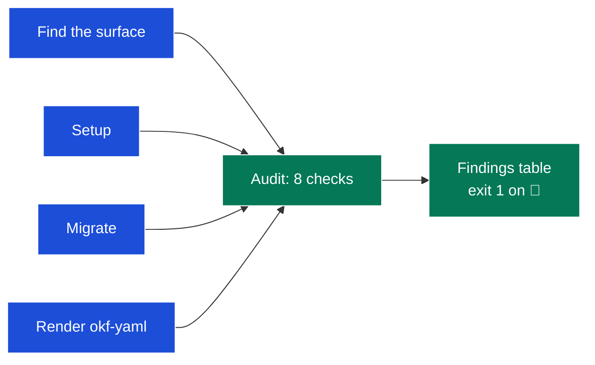
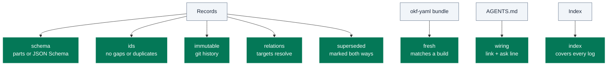

# adr

Sets up, migrates, renders and audits a repo's architecture decision records.
It turns "do our ADRs hold together?" into one command that exits non-zero, so the same check runs for an agent and in CI.
It judges the structure of the records, never the quality of their reasoning.

## Table of Contents

<details><summary>Click to expand</summary>

<!--TOC-->

- [adr](#adr)
  - [Table of Contents](#table-of-contents)
  - [Quickstart](#quickstart)
  - [Architecture](#architecture)
  - [Reference](#reference)
    - [Troubleshooting](#troubleshooting)
  - [For maintainers](#for-maintainers)

<!--TOC-->

</details>

## Quickstart

In Claude Code:

```text
/adr                          # audit the repo's decision records
/adr setup files              # create adrs/ with a template, an index and the AGENTS.md link
/adr setup log                # or a single-file ADRs.md log
/adr migrate okf-yaml         # move an existing surface to YAML records with generated markdown
/adr render adrs/             # regenerate an okf-yaml bundle from its .yml records
```

Driving the audit directly, for example as a CI step (exit 1 on any 🔴 finding):

```sh
uv run --no-project --with PyYAML --with Jinja2 --with jsonschema \
  skills/adr/scripts/adr_audit.py .
```

The escape hatch is the JSON form, for picking findings out with `jq`:

```sh
uv run --no-project --with PyYAML --with Jinja2 --with jsonschema \
  skills/adr/scripts/adr_audit.py . --json \
  | jq -r '.findings[] | select(.severity == "🔴") | "\(.check)\t\(.where)"'
```

## Architecture



Every mode starts by finding the surface: a Dialect line in `docs/CONVENTIONS.md`, else the shallowest `adrs/`, `adr/`, `decisions/`, `ADRs.md` or `DECISIONS.md`.
Every mutating mode ends by running the audit, so none is done until the audit passes.

<details><summary>What the audit checks</summary>



The full table, with what makes each check 🔴 or 🟡, is in [SKILL.md](SKILL.md#audit-mode).

</details>

## Reference

- Operating manual (modes, discovery, the check table, setup and migrate steps): [SKILL.md](SKILL.md)
- Preferred shape of one record, for each layout: [resources/adr_template.md](resources/adr_template.md)
- What a decision record captures: [resources/adr_decision_theory.md](resources/adr_decision_theory.md)
- The named `okf-yaml` convention (schema, relation vocabulary, finding table, migration): [resources/adr_okf_yaml.md](resources/adr_okf_yaml.md)
  - The contract: [`resources/okf_yaml/record.schema.json`](resources/okf_yaml/record.schema.json)
  - A worked bundle, doubling as the golden fixture: [`resources/okf_yaml/example/`](resources/okf_yaml/example)

Requirements:

- `uv`, which resolves PyYAML, Jinja2 and jsonschema from pypi.org on the first run.
- `git`, for the immutability check. Without history that check is a 🟡 finding, not a pass.

No mode calls a paid API.
Audit is read-only; setup, migrate and render write files and should run on a branch.

### Troubleshooting

| Symptom | Cause / fix |
|---------|-------------|
| `immutable` flags a record you only marked superseded | The edit touched more than the Status or Relates to row. Move the rest of the change into the new record. |
| `immutable` flags every record after a reformat | A migration to the template moves text under new headings. Accept the finding as part of that migration, in the same change. |
| `fresh` flags `graph.html` after copying a bundle | The viewer embeds its directory name. Render the bundle again. |
| `schema` rejects keys like `lens` or `problem` | The schema dropped them. Delete the keys; the lens fields stay. |
| Audit finds surfaces inside other repos or test data | It should not: directories with their own `.git` and every `fixtures/` are skipped. Pass `--surface` to name the surfaces explicitly. |
| `index` flags a scoped log you meant to keep separate | The root index must reach every log. Link it from the root index, even as "scoped to packages/x". |
| Exit 2 with "holds no decision records" | A `--surface` path has no `NNNN-*.md`, `NNNN-*.yml` or `ADRs.md` records. Check the path. |

## For maintainers

Design rationale, decision log and extension checklist: [CLAUDE.md](CLAUDE.md).
