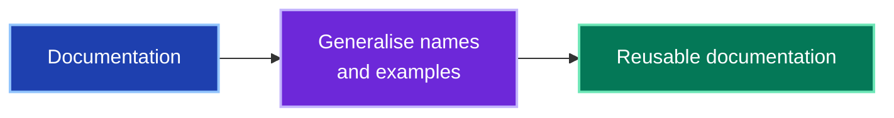
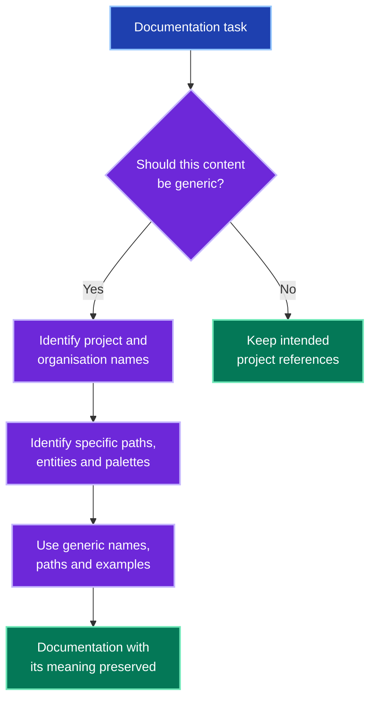

# agnostic

Makes documentation reusable by replacing project, client and company details with generic names and examples.
Use it when writing public documentation, removing branding or checking for leaked names.

## Quickstart

```text
/agnostic
```

Apply it to documentation that should be generic.
Source code, tests and product documentation intended to name the real project stay outside its scope.

## Workflow



Replace identifying details while preserving the explanation.

<details>
<summary>Complete workflow: scope, identifying details and generic replacements</summary>



The intended audience determines whether real names belong in the document.

</details>

## Reference

The complete operating instructions live in [SKILL.md](SKILL.md).
