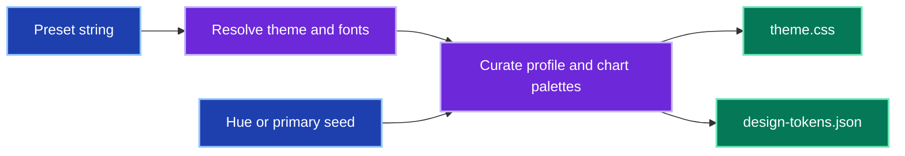
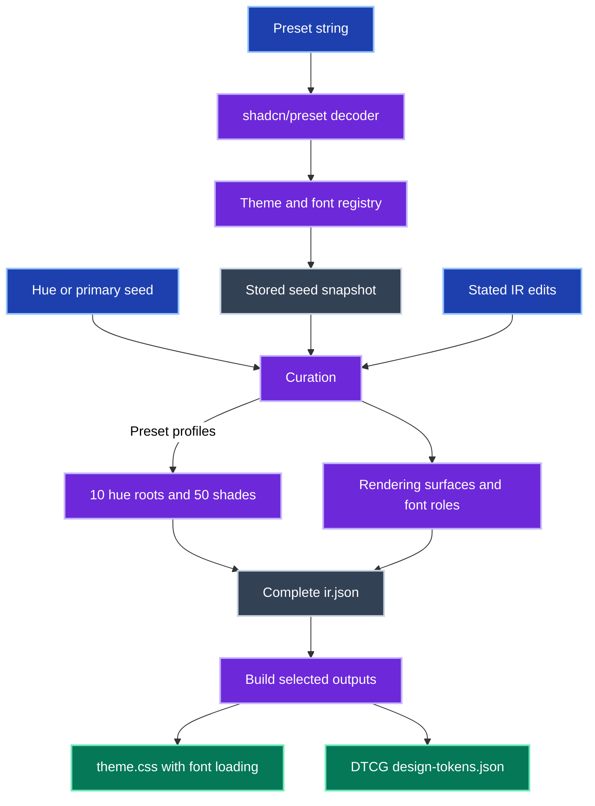

# Design profiles

Generate shared theme CSS and DTCG design tokens from one shadcn preset string.
The profile includes light and dark modes, font loading, rendering surfaces, and ten five-shade chart palettes.
Hue and primary-colour seeds remain available for offline authoring.
All scripts run under Node.js or Bun; saved profiles rebuild without Python or installed packages.
Example seeds explicitly set `radius`, including `0` for square corners; `radius.dark` can override dark mode.
Every CSS export includes the shadcn theme-variable contract, plus fonts, expanded palettes, and profile chrome variables.

## Overview

A preset resolves its theme and fonts before curation produces reusable profile outputs.



<details>
<summary>Preset resolution, curation and export</summary>

The stored seed supports offline curation, with rendering surfaces and chart palettes baked into the IR.



</details>

## Generate a profile

From the repository root, install the adapter dependencies and provide a preset code:

```bash
bun install --cwd skills/design-profiles/scripts --frozen-lockfile
bun skills/design-profiles/scripts/shadcn.mjs b5cR4pgAc --name demo
```

The command writes `.design-profiles/demo/theme.css` and `.design-profiles/demo/design-tokens.json`.
Its saved seed and IR support offline rebuilds.
Use `--format css` or `--format tokens` to select one output.
Omitting `--name` uses `preset-CODE`.

The first import requires registry access.
Generated CSS loads fonts from CDN stylesheets.
The [preset reference](resources/shadcn-presets.md) explains output tokens, chart formulas, and rebuilding.
The [runtime instructions](SKILL.md) also cover hue, primary-colour and shipped example seeds.

## Maintain the skill

Read [AGENTS.md](AGENTS.md) and the [decision log](docs/decisions.md) before changing curation rules.
Run the complete producer gate:

```bash
make -C skills/design-profiles/scripts ci
```

The JavaScript integration tests resolve the real registry and require network access.
Bun fixture tests exercise offline curation, source preservation, chart expansion, and exports.
CLI tests run under both Node.js and Bun with no Python or uv available on PATH.
