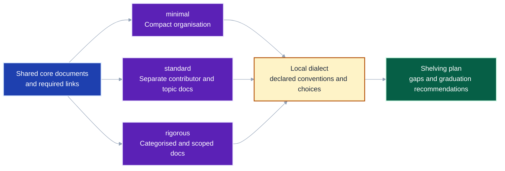
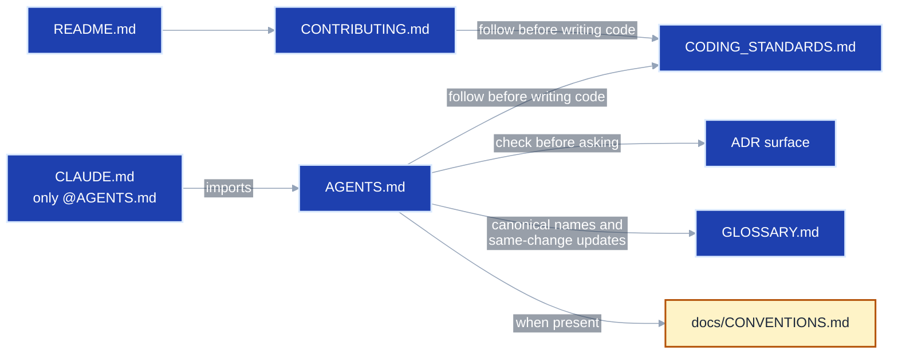
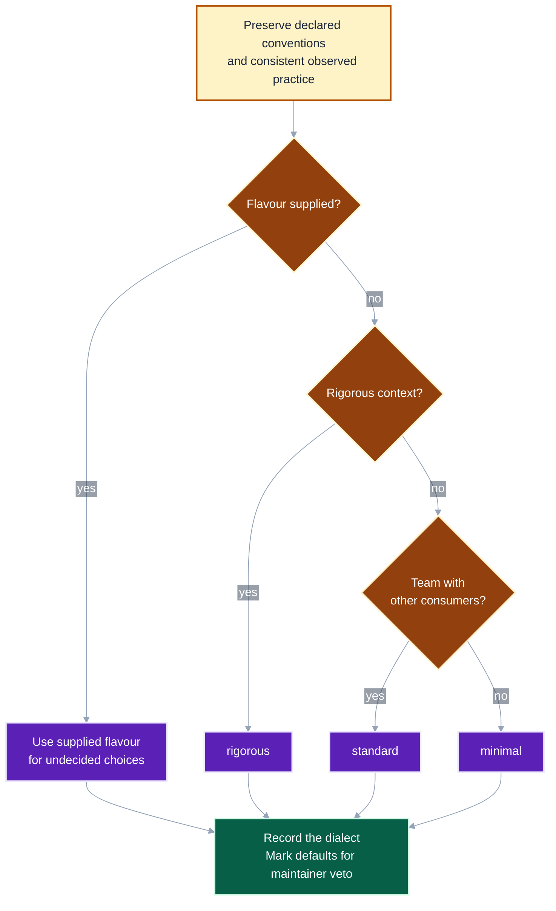
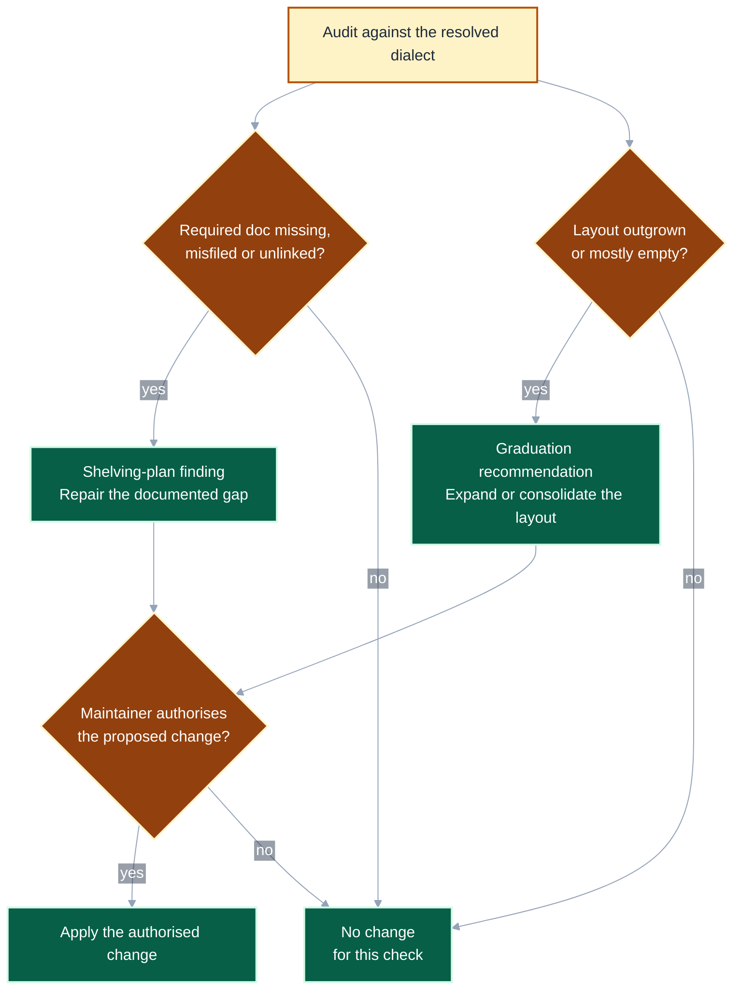

# Choose a flavour that fits the repository

Flavours size the organisation around a shared set of documents.
A shelving plan distinguishes gaps in that organisation from recommendations to change its scale.
This visual guide accompanies the complete [flavour reference](flavours.md).
Code font names an exact file, directory or flavour.

Guide contents

<!--TOC-->

- [Choose a flavour that fits the repository](#choose-a-flavour-that-fits-the-repository)
  - [Every flavour keeps the same core](#every-flavour-keeps-the-same-core)
  - [Choose a starting preset, preserve local decisions](#choose-a-starting-preset-preserve-local-decisions)
  - [Separate required fixes from optional graduation](#separate-required-fixes-from-optional-graduation)

<!--TOC-->

## Every flavour keeps the same core

What changes when a repository chooses a larger preset?
The core still covers orientation, contribution, coding standards, agent instructions, decisions and vocabulary.

**A smaller flavour makes the documents shorter and the layout flatter; it retains the core documents and links.**

Required core documents and the links between them

Which connections make the core usable by both people and agents?
The conventions link applies whenever that file exists.

**Presence and links are both part of the core contract.**

The main layout differences are how readers reach the detail:

| Flavour | Human documentation | Agent and decision documentation |
|---|---|---|
| `minimal` | Sections in `README.md`, brief `CONTRIBUTING.md` | Root agent pair and a single `ADRs.md` log |
| `standard` | README hub, full contributor workflow, flat `docs/topic.md` files | `docs/CONVENTIONS.md`, scoped agent pairs where needed, declared decision layout |
| `rigorous` | Diátaxis categories, `docs/internals/`, directory README indexes | Per-package agent pairs, indexed decision files and linked scoped logs |

The [full comparison](flavours.md#the-three-flavours) also covers health files, glossary organisation and decision layouts.

## Choose a starting preset, preserve local decisions

How does init choose a flavour without overwriting an existing layout?
User rulings outrank declared conventions, observed practice and defaults, in that order.
Multiple teams, external contributors, regulation or a public platform suggest a rigorous context.

**A preset fills undecided choices; declared and consistently observed conventions keep their authority.**

For example, choosing `standard` for a repository with an established decision directory does not require moving that directory.
Init records the observed choice in the dialect instead.
See the [authority ladder](../SKILL.md#step-0-discover-the-dialect-every-mode) and [init workflow](../SKILL.md#init-mode).

## Separate required fixes from optional graduation

Does outgrowing a flavour make a compliant repository wrong?
Audit checks against the resolved dialect and reports scale changes separately in the shelving plan's **Graduation** section.
The two checks are independent: a repository can need both repairs and graduation recommendations.

**Graduation is a recommendation requiring acceptance, and it can simplify a layout as well as expand one.**

These examples show how the distinction appears in a shelving plan:

| Observation | Plan section | Proposed action |
|---|---|---|
| `CONTRIBUTING.md` is missing | Findings | Add the required contributor guide, even for `minimal` |
| Flat topic files mix genres readers confuse | Graduation | Recommend categorised folders, subject to acceptance |
| A `rigorous` layout has mostly empty topic folders | Graduation | Recommend consolidation, subject to acceptance |

File-count and size triggers are approximate prompts to inspect the layout, not automatic migration rules.
Use the [graduation-trigger reference](flavours.md#graduation-triggers-when-to-introduce-each-scale-up-element) for the individual thresholds.
Use the [shelving-plan contract](../SKILL.md#4-the-shelving-plan) to report findings and recommendations.
