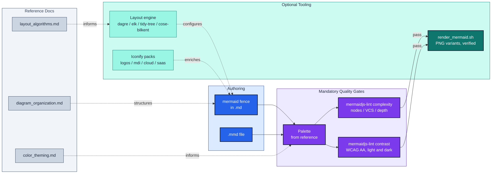

# mermaidjs-diagrams

Render and maintain Mermaid.JS diagrams with **visual-clarity enforcement**.

## Features

- **Render** `.md` files containing ```` ```mermaid ```` fences to PNG. Two
  variants by default, dark+transparent and default+white, because a diagram
  has to read on a dark host and a light host and one image cannot do both.
  Every artifact is verified as a decodable PNG: a renderer exiting 0 without
  writing an image is a failure, not a pass.
- **Self-triaging renders**: Chromium failures are classified (npm cache,
  missing browser, sandbox denial, network, diagram syntax, or unknown), the
  two mechanically remediable classes are retried once, and only one class
  ever means "edit the diagram."
- **One published lint for every gate (required, not optional)**: every
  diagram MUST derive its palette from `resources/color_theming.md` and pass
  [`@jpeakai/mermaidjs-lint`](https://jpeakai.github.io/jpai-mermaidjs-lint/).
  That one tested package guarantees every label reads in light and dark
  themes, every diagram parses with Mermaid's own parsers, visual complexity
  (node count, visual-complexity score, subgraph depth) is scored against
  cognitive-load thresholds, and extra rules plug in. `SKILL.md` "Why this is
  mandatory" carries the reasoning.
- **Ad-hoc pair checker**: `scripts/color_contrast.ts` scores any two CSS
  colours (hex, rgb, oklch, named), WCAG 2.x plus APCA Lc, and composites a
  translucent fill over a backdrop. The lint has no equivalent, so it stays.
- **Layout engines**: dagre, elk, tidy-tree and cose-bilkent (mindmap only),
  selectable per diagram via YAML frontmatter. `look: classic | handDrawn | neo`.
- **Icon packs**: Iconify (logos, mdi, cloud, saas) for `architecture-beta`;
  Font Awesome for flowcharts.

## How it fits together



*Mermaid source flows left-to-right through two mandatory gates, structural
complexity and color contrast, both run by `@jpeakai/mermaidjs-lint`, before
rendering. Reference docs (dotted)
supply the rules each stage enforces.*

## Quick start

```bash
bunx @jpeakai/mermaidjs-lint path/to/doc.md                       # the gates: parse, complexity, contrast
bash .claude/skills/mermaidjs-diagrams/scripts/render_mermaid.sh path/to/doc.md
make -C .claude/skills/mermaidjs-diagrams/scripts install-ts      # once: bun deps for color_contrast.ts
make -C .claude/skills/mermaidjs-diagrams/scripts cli-demo
```

See [`SKILL.md`](SKILL.md) for usage, [`resources/`](resources/) for deep dives,
[render triage](resources/render_troubleshooting.md) when a render fails for
reasons that aren't the diagram, and [`scripts/CLAUDE.md`](scripts/CLAUDE.md)
for the maintenance guide.
