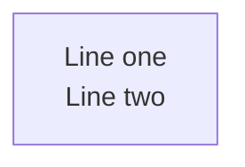
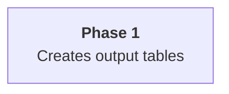

# Context

Render and maintain Mermaid.JS diagrams with **visual clarity enforcement**.
Works for ANY project. Yoghourdjian et al., 2020 (arXiv:2008.07944) found difficulty
**finding the shortest path** in dense diagrams above ~50 nodes — a path-tracing
result, not a comprehension budget; tighter limits here rest on segmenting instead.

Diagrams live as ` ```mermaid ` code fences inside `.md` files.

# Document types (route first)

For a **whole document** rather than a single diagram, read the matching type
**before drafting**: it governs the *sequence* of diagrams and the invariants
across them. Skip when the task is one diagram, a render, or an audit.

| The request says | Read |
|---|---|
| "pr-review", "PR review document", "visual diff" | `resources/document-types/pr-review.md` |
| "plan", "implementation plan", "proposed changes" | `resources/document-types/plan.md` |
| "educational", "illustrative guide", "explainer", "one-pager on X", "distil X", "explain X visually", "teach me X" | `resources/document-types/educational.md` |
| Unsure which, or adding a new type | `resources/document-types/README.md` |

**Never inline a live `-beta` fence** (`architecture-beta`, `block-beta`,
`packet-beta`, `radar-beta`, `sankey-beta`, `treemap-beta`, `xychart-beta`):
GFM hosts pin an older Mermaid version, so they render locally but show as raw
code blocks on GitHub. Ship a PNG/SVG plus sibling `.mmd` — see `resources/gfm_beta_diagrams.md`.

---

# Required for every diagram

Two requirements apply to **every** diagram this skill authors or reviews.
Not "consider," not "when time permits" — **mandatory, enforced, verifiable**.

## 1. Apply the color theory reference

Before authoring or revising any diagram, read `resources/color_theming.md`.
Every diagram MUST apply custom colors derived from that reference to encode
its meaningful categories, states, phases, or roles. Never leave an authored
diagram on Mermaid's default unstyled palette. That file covers:

- WCAG-aware palettes that work in both dark and light viewer themes.
- HSL encoding conventions so sibling nodes stay visually coherent.
- Subgraph-coloring patterns that don't clash with node fills.

Do not ad-hoc pick `#random` hex values. If the palette you need isn't in
`color_theming.md`, add it there first (with the same contrast-verified
shape as existing entries), then use it — don't fork the convention per
diagram.

## 2. Run `@jpeakai/mermaidjs-lint` before declaring the diagram done

Every diagram MUST pass the published lint,
[`@jpeakai/mermaidjs-lint`](https://jpeakai.github.io/jpai-mermaidjs-lint/).
It is one tested package that carries all three gates this skill used to ship
as scripts, and it guarantees four things:

1. **Every label is readable in light and dark themes** (the contrast rules).
2. **Every diagram renders**: each fence parses with Mermaid's own parsers.
3. **Visual complexity is scored**, so an over-budget diagram gets simplified.
4. **Extra rules plug in** from `.mermaidjs-lint/rules` or a
   `mermaidjs-lint-plugin-*` dependency.

```bash
bunx @jpeakai/mermaidjs-lint path/to/doc.md        # or: npx -y @jpeakai/mermaidjs-lint path/to/doc.md
bunx @jpeakai/mermaidjs-lint docs/                 # a directory is walked for .md and .mmd files
```

Exit code 0 means no findings. Exit 1 means findings remain and is a
**blocker**: fix the palette, split the diagram, or drop the custom styling.
Exit 2 is a usage error. Never relax a budget or skip the run to get to 0.

`--fix` applies only the fixes it can prove safe (an unterminated fence, a label
colour below AA) and reports what remains. Review its edit like any other diff.

**The contrast rules are context-aware** (`--profile auto|github|mkdocs-material`,
default `auto` = mkdocs-material when an ancestor holds `mkdocs.yml`, else github):

- **github** (plain markdown / `mmdc`): you control the text, so every `fill`
  needs a `color:` at 4.5:1 and every `stroke` 3:1 against its fill
  (see `color_theming.md` §3). **Except in an `erDiagram`**, where Mermaid paints
  the fill on even attribute rows only and the odd rows keep a theme surface that
  flips with the reader. The lint scores an entity against every row background
  it draws, in both themes. An opaque `fill` + `color:` pairing fails there by
  design; use the translucent recipe (no `color:`, see
  `resources/color_host_themed_renderers.md`).
- **mkdocs-material**: the host theme **forces** the label text and ignores your
  `color:`. Here the correct pattern is the **opposite**: *no* `color:`, a
  **translucent** fill, and the diagram must read in both light and dark. See
  `resources/color_host_themed_renderers.md` and force the profile with:

  ```bash
  bunx @jpeakai/mermaidjs-lint docs/ --profile mkdocs-material
  ```

**A `sequenceDiagram` is scored by its theme colours.** It has no style lines,
so the lint reads YAML frontmatter and `%%{init}%%` theme variables, resolves
the rest with Mermaid's own theme engine, and scores participants, human actors,
lifelines, messages and arrows, notes, frames, activation bars, `autonumber`
numbers and `rect` backgrounds in light and dark. A `themeCSS` override, or a
colour Mermaid cannot read, is reported as `contrast-directive-unauditable`, a
blocker like any other finding. See `resources/contrast_tooling.md` for the
full sequence surface.

**A host with its own page colours passes them as the canvas.** Page-backed
colours (translucent fills, edge label boxes, sequence messages, lifelines and
loop text) are scored on GitHub's page (`#ffffff` and `#0d1117`) by default.
When the diagram is drawn on another page, such as a documentation viewer with
its own light and dark surface, pass that page so the lint scores what the
reader sees. The canvas applies under the `github` profile only:

```bash
bunx @jpeakai/mermaidjs-lint docs/ --profile github --canvas-light '#faf8f9' --canvas-dark '#101010'
```

For ad-hoc colour-pair checks (picking from a screenshot, validating a theme
token pair, compositing a translucent fill), the lint has no equivalent, so the
skill keeps its own calculator for that one job:

```bash
bun run .claude/skills/mermaidjs-diagrams/scripts/color_contrast.ts "<fg>" "<bg>"
```

## Why this is mandatory

A diagram that's illegible to a low-vision reader, or that melts into the
background under a dark GitHub theme, **fails its job** — it communicates
nothing. The cost of the audit is seconds; the cost of shipping
unreadable documentation is repeated across every reader for the life of
the project. The failure mode of skipping this check is silent (the
author can read it fine on their screen; readers quietly give up). That's
the same Type-2-silent-failure pattern the complexity linter was built to
prevent — the contrast check is its twin, gating the **color** axis of
visual clarity the way complexity checks gate the **structural** axis.

Wire `bunx @jpeakai/mermaidjs-lint` into any `make ci` / pre-commit pipeline
that touches docs. One command gates both axes.

> Deep-dive references:
> - `resources/color_theming.md` — conceptual core: HSL encoding, dark/light mode safety, hierarchy, subgraph coloring
> - `resources/color_palette_recipes.md` — the four palette recipes, a worked example for each, and the Tailwind hex lookup
> - `resources/color_host_themed_renderers.md` — translucent dual-theme fills for host-themed renderers (MkDocs Material)
> - `resources/contrast_tooling.md`: the lint's contrast profiles and rules, and the ad-hoc pair calculator
> - [`@jpeakai/mermaidjs-lint` rules](https://jpeakai.github.io/jpai-mermaidjs-lint/): every rule with failing and fixed examples
> - `scripts/color_contrast.ts` — generic WCAG + APCA calculator for ad-hoc pairs

---

# Rendering

## Quick render (recommended)

Use the bundled script to render both standard variants (dark+transparent and default+white PNGs) in one command. Two variants are the floor because the skill must work on dark and light hosts alike; one image cannot serve both:

```bash
bash .claude/skills/mermaidjs-diagrams/scripts/render_mermaid.sh path/to/document.md
```

Output lands in `.mmdc_cache/{variant}/path/to/document-*.png`.

`mmdc` reads the markdown file, extracts every mermaid fence, and renders each as a
numbered image artefact. The script exits 0 only when every expected PNG was written
**and verified** (magic bytes + non-zero dimensions) — a renderer that exits 0 without
producing an image is treated as a failure, not a success.

## Custom variants

For formats beyond the two defaults, drive `mmdc` directly. Three parameters form a
**variant tuple** — theme (`-t`: `default`/`dark`), background (`-b`:
`white`/`black`/`transparent`), format (`-e`: `png`/`svg`) — which also names the
output folder, `{theme}_{backgroundColor}_{format}`.

> Full variant documentation, with copy-paste `mmdc` invocations for every
> combination: `resources/pattern_render_markdown.md`

## When a render fails: triage, don't bail

Rendering drives a real Chromium, so it fails for reasons that have nothing to
do with your diagram. **Classify before you touch the source** — four
independent inputs can break, and only one of them is the diagram:

| stderr signature | Class | What to do |
|------------------|-------|-----------|
| `EPERM` / `EACCES` / `_cacache` | `NPM_CACHE_PERMISSION` | Task-local `NPM_CONFIG_CACHE` (script retries this itself) |
| `Could not find Chrome`, `chrome-headless-shell` | `BROWSER_MISSING` | Point at an installed Chromium, or let Puppeteer download one — never both wrong at once |
| `MachPortRendezvous`, `Permission denied (1100)` | `SANDBOX_DENIED` | Stop retrying; re-run **only** the render in a browser-capable execution class |
| `ENOTFOUND` / `ETIMEDOUT` | `NETWORK_UNREACHABLE` | Ship the fences unrendered — GitHub/GitLab render them natively |
| `Parse error`, `UnknownDiagramError` | `DIAGRAM_SYNTAX` | **The only class that means edit the diagram** |

`render_mermaid.sh` does the classification and the mechanical remedies itself: it resolves a
browser, isolates the npm cache, classifies stderr, retries once per remediable
class, and prints `class` + `evidence` + `remedy` when it genuinely cannot
proceed. Supporting modes:

```bash
bash .claude/skills/mermaidjs-diagrams/scripts/render_mermaid.sh --doctor              # probe the host, render nothing
bash .claude/skills/mermaidjs-diagrams/scripts/render_mermaid.sh --verify out/*.png    # is this actually a decodable PNG?
```

Never respond to an environmental failure by simplifying, restyling, or
deleting a diagram that passed the gates — and never report a render as done
without a verified artifact.

> Full triage procedure, escalation recipes, and field evidence:
> `resources/render_troubleshooting.md`

## Icon packs

```bash
# Iconify icons (architecture-beta diagrams)
--iconPacks @iconify-json/logos @iconify-json/mdi

# Custom URL-based packs
--iconPacksNamesAndUrls "vendor#https://example.com/icons.json"
```

Flowchart diagrams with Font Awesome (`fa:fa-icon`) need no `--iconPacks` flag.

---

# Complexity Analysis

Analyze diagrams to ensure they stay within cognitive load thresholds. The
same lint run carries the complexity rules; it reads `.mmd` and `.md` files
(and directories of either) through Mermaid's canonical parsers, so
`architecture-beta`, nested subgraphs, and edge decorators all parse correctly.

```bash
bunx @jpeakai/mermaidjs-lint path/to/docs/
bunx @jpeakai/mermaidjs-lint path/to/diagram.mmd --preset low
bunx @jpeakai/mermaidjs-lint path/to/docs/ --json
bunx @jpeakai/mermaidjs-lint --list-rules        # every active rule, by category
```

## Output format

One finding per line, `file:lines rule-id message`, then a count (here under
`--preset low`):

```
path/to/file.md:1-17 complexity-node-count-acceptable-exceeded 15 nodes > 12 acceptable threshold
1 finding(s) in 1 file(s)
```

| Rule | Meaning |
|------|---------|
| `parse-diagram-unparseable` | A multi-line diagram Mermaid's parser reads as zero nodes |
| `parse-fence-unterminated` | A mermaid fence that is never closed (`--fix` closes it) |
| `complexity-node-count-hard-limit` | Nodes above the absolute cap |
| `complexity-node-count-cognitive-limit` | Nodes above the cognitive limit (Yoghourdjian 2020, path-tracing threshold) |
| `complexity-node-count-acceptable-exceeded` | Nodes above the preset's readable threshold |
| `complexity-visual-score-critical` | VCS above the critical threshold |
| `complexity-visual-score-acceptable-exceeded` | VCS above the preset's readable threshold |
| `complexity-subgraph-nesting-too-deep` | Subgraphs nested three or more levels deep |

A diagram that does not parse is not scored for complexity: complexity is never
evaluated against unparseable input.

## Density presets

| Preset | Nodes | VCS | Typical Use |
|--------|-------|-----|-------------|
| Low (`--preset low`) | <=12 | <=25 | Overview diagrams |
| Medium (`--preset medium`) | <=20 | <=40 | README diagrams |
| High (`--preset high`) | <=35 | <=60 | Detail diagrams (default) |

## Complexity formula

```
VCS = (nodes + edges*0.5 + subgraphs*3) * (1 + depth*0.1)
```

Ratings: **ideal** / **acceptable** / **complex** / **critical**

When a diagram is rated **complex** or **critical**, split it into simplified and
detailed versions. See `resources/diagram_organization.md` for the dual-density
approach and naming conventions.

---

# Contrast Analysis

Contrast checking is **mandatory**, not optional. See "Required for every
diagram" above, which carries the mandate and the commands you need.

The lint's contrast rules audit every `classDef`/`style` directive inside
`.mmd`/`.md` files:

| Rule | Meaning |
|------|---------|
| `contrast-text-below-aa` | Label text below 4.5:1 against its fill (`--fix` can repair it) |
| `contrast-border-below-ui-minimum` | A border below 3:1 against its fill |
| `contrast-directive-unauditable` | A style directive whose contrast cannot be audited |

`scripts/color_contrast.ts` scores any two CSS colours ad hoc (hex, rgb, oklch,
named), and exits `0` when every pair passes AA, `1` on any failure, `2` on
usage error. Neither tool needs a browser, so both keep working when rendering
is blocked.

> Full profile behaviour, the calculator's flags and its output fields
> (`ratio` / `rating` / `apca_lc`): `resources/contrast_tooling.md`

---

# Layout Algorithms

Mermaid supports several layout engines (`dagre` default, `elk`, `tidy-tree`,
`cose-bilkent`) selected via YAML frontmatter inside the diagram source:

```yaml
---
config:
  layout: elk
  look: classic
  elk:
    mergeEdges: true
    nodePlacementStrategy: BRANDES_KOEPF
---
flowchart LR
    ...
```

Use `elk` for dense architecture diagrams (cleaner orthogonal routing), stick
with `dagre` for simple flows. The `layout` key is only honored by **flowchart**,
**state**, and **mindmap** diagrams — others use their own built-in algorithms.

> Full documentation: `resources/layout_algorithms.md`
> Rendered comparison gallery (dagre vs. elk vs. tidy-tree): `resources/examples/README.md`

---

# Diagram Organization

For projects with multiple architectural diagrams, organize around **lenses**
(perspectives) and **dual-density** fences inlined in the project README.

> Full documentation: `resources/diagram_organization.md`

## Primary pattern: inline dual-density

Each lens gets a README section with **two** mermaid fences: a simplified
overview (always visible, <=12 nodes) and a detailed reference (wrapped in
`<details>` collapsible, <=35 nodes). Both fences live in the markdown prose —
no separate `.mmd` files, no pre-rendered PNG pipeline (GitHub and GitLab
render mermaid fences natively).

````markdown
### System Overview

```mermaid
{simplified — <=12 nodes}
```

*Caption* | VCS: X.X ✅

<details>
<summary>📋 Complete diagram (N nodes)</summary>

```mermaid
{detailed — <=35 nodes}
```

</details>
````

## Workflow for codebase exploration

When invoked as "generate architecture diagrams for this codebase," do **not**
try to hold the whole codebase in the main agent's context. Delegate the
enumeration step to subagents so the diagram-authoring agent keeps a clean
context to reason in. Loop per lens:

1. **Enumerate components — via subagents and LSP, not raw grep.**

   Dispatch **one `Agent(subagent_type="Explore")` per lens** in parallel.
   Each subagent reports back only the structured component list for its
   lens, keeping the main agent's context clean for diagram authoring.

   Inside each subagent, prefer the **`lsp` skill** when available — it
   provides language-server-backed symbol enumeration, cross-references
   (which map directly to diagram edges), and impact analysis (which
   surfaces coupling strength). Fall back to `Grep` / `Glob` only where the
   LSP can't reach (shell scripts, config files, IaC):

   | Lens | Primary LSP queries | Fallback |
   |------|---------------------|---------|
   | `architecture` | Top-level symbols, module boundaries, public exports | `Glob` for directory tree |
   | `data-flow` | References for each I/O helper (DB client, HTTP client, event bus) | `Grep` for `fetch`/`requests`/SQL strings |
   | `deployment` | — | `Glob` + read for Dockerfiles, Terraform, `*.yaml` manifests |
   | `security` | References to auth/crypto helpers, middleware symbols | `Grep` for decorators, middleware wiring |
   | `sequence` | Call graph for an entry-point symbol | `Grep` for route/handler decorators |
   | `state` | Enum / state-machine symbols and their transition call sites | `Grep` for state-constant usage |

   The subagent returns **a ≤500-word structured report** — a component list,
   edge list, and any notable external integrations. No raw code.

2. **Draft the detailed fence first** (<=35 nodes, subgraphs by
   responsibility, edge labels for what travels between nodes). Work from the
   subagent reports — do not re-explore the code yourself.

3. **Collapse to the simplified fence** — replace each subgraph with a single
   node, drop internal wiring, keep the top-level narrative.

4. **Validate: the lint is mandatory** and may not be skipped. One run covers
   parsing, complexity (structural clarity) and contrast (colour clarity):
   ```bash
   bunx @jpeakai/mermaidjs-lint README.md
   ```
   A non-zero exit is a **blocker**. Fix by shrinking,
   splitting, or recoloring — do not relax the budget, do not skip the
   audit. If you added custom colors, their palette must come from
   `resources/color_theming.md`, not from ad-hoc hex picks.

5. **Render PNGs only if needed** for PDFs / slides / non-mermaid viewers via
   `scripts/render_mermaid.sh`. Do not re-link them from the README that
   already holds the fences. If the render fails, run the triage above —
   a browser or cache failure is never a reason to change a diagram that
   just passed both gates.

### Why subagents + LSP over direct exploration

- **Context hygiene.** Exploration pulls huge amounts of code into context;
  diagram authoring needs a clean slate to reason about naming, layout, and
  layering. Subagents return structured summaries, not raw files.
- **Parallelism.** Dispatching one subagent per lens in a single message runs
  them concurrently — the six-lens survey takes ~one wall-clock lens-time.
- **Cross-reference accuracy.** LSP's `find references` produces a *real*
  call graph; grep produces a text-match approximation that misses method
  dispatch, dynamic imports, and renames. For edges labeled "calls" or
  "invokes," LSP is authoritative.
- **Failure modes to watch.** If the LSP skill reports no server is
  available for the codebase's primary language, don't pretend — tell the
  user, and fall back to `Explore` + `Grep` with the caveat that edges may
  be undercounted.

## Key concepts

- **Lenses**: architecture, data-flow, deployment, security, sequence, state.
- **Density tiers**: simplified (overview, always-visible) vs detailed
  (reference, collapsed).
- **Split, don't relax** — if the detail fence exceeds 35 nodes, break the
  lens into per-subsystem sections rather than loosening the budget.
- **Legacy file-per-diagram** pattern (`docs/diagrams/{lens}--{scope}.md` +
  PNG links) remains supported for wikis/static sites that can't inline
  mermaid — see `resources/diagram_organization.md`.

---

# Common Pitfalls

## Multiline Text in Node Labels

**`\n` does NOT work** in flowchart node labels — renders as garbled characters.
Use `<br/>` instead:



Alternative for Mermaid v10.1+: markdown strings with real newlines:


| Feature | `<br/>` tags | Markdown strings |
|---------|-------------|-----------------|
| Mermaid version | All versions | v10.1+ |
| Inline formatting | No | Bold, italic |
| Auto-wrap | No | Yes |

### Where `<br/>` does NOT work

- **Subgraph labels** — use short single-line titles
- **erDiagram** — uses different syntax

## Avoid Unicode in Node Labels

Characters like U+21B3, U+2192, U+00B7 can cause rendering failures in mmdc even
when they display in browser previews. Stick to **ASCII-only text** in node labels.

---

# Quick Reference

## Variant Tuples

| Variant | Flags | Best For |
|---------|-------|----------|
| `dark_transparent_png` | `-e png -t dark -b transparent` | Dark UIs, slides (default) |
| `default_white_png` | `-e png -t default -b white` | README, light docs, print |
| `dark_transparent_svg` | `-e svg -t dark -b transparent` | Scalable dark docs |
| `default_white_svg` | `-e svg -t default -b white` | Scalable light docs |

## Exit Codes

| Tool | 0 | 1 | 2 |
|------|---|---|---|
| `@jpeakai/mermaidjs-lint` | No findings | Findings remain, or a plugin failed to load | Usage error (bad flag / missing file) |
| `color_contrast.ts` | All pairs pass WCAG AA (>=4.5:1) | Any pair fails | Usage error |
| `render_mermaid.sh` | Every variant rendered **and verified** as a real PNG | Render failure (stderr carries `class` / `evidence` / `remedy`) or usage error | — |
| `mmdc` | All rendered | Render failure (see stderr) | — |

## Render failure classes

`NPM_CACHE_PERMISSION` · `BROWSER_MISSING` · `SANDBOX_DENIED` ·
`NETWORK_UNREACHABLE` · `DIAGRAM_SYNTAX` · `UNKNOWN` — only `DIAGRAM_SYNTAX`
means the diagram is at fault. See `resources/render_troubleshooting.md`.

## Resources

| File | Content |
|------|---------|
| `resources/document-types/README.md` | How to pick a document type; the invariants every type shares; how to add one |
| `resources/document-types/pr-review.md` | PR review companion: a visual diff of a change, section by section |
| `resources/document-types/plan.md` | Implementation plan: proposed changes, laid out before the code exists |
| `resources/document-types/educational.md` | Educational / illustrative guide: concept beats, monotonic build, shared palette, one-pager contract |
| `resources/gfm_beta_diagrams.md` | Why `-beta` types fail on GFM hosts; render-to-PNG/SVG with sibling `.mmd` pattern; non-beta alternatives |
| `resources/color_theming.md` | Conceptual core: HSL encoding, dark/light mode safety, hierarchy, subgraph coloring |
| `resources/color_palette_recipes.md` | Four palette recipes, a worked example for each, and the Tailwind v3 hex lookup |
| `resources/color_host_themed_renderers.md` | Translucent dual-theme fills for host-themed renderers (MkDocs Material) |
| `resources/contrast_tooling.md` | Contrast profiles and rules of `@jpeakai/mermaidjs-lint`, and the full CLI surface of the ad-hoc pair calculator |
| `resources/render_troubleshooting.md` | Render failure triage: signature → class → remedy, artifact verification, escalation, when to stop |
| `resources/diagram_organization.md` | Lens naming, dual-density approach, README sync |
| `resources/layout_algorithms.md` | `layout` + `look` config for dagre / elk / tidy-tree / cose-bilkent, ELK tuning keys, per-diagram-type support |
| `resources/pattern_render_markdown.md` | Full render-from-markdown documentation |
| `resources/examples/` | Sample `.mmd` files and rendered PNG output (includes layout comparison gallery) |
| `resources/iconify/` | Iconify icon-pack reference (subdirectory — see files below) |
| `resources/iconify/iconify_setup.md` | Iconify icon pack setup guide |
| `resources/iconify/iconify_logos.md` | Available Iconify logo icons |
| `resources/iconify/iconify_mdi.md` | Available Material Design icons |
| `resources/iconify/iconify_cloud.md` | Cloud-provider icon catalogue |
| `resources/iconify/iconify_saas.md` | SaaS / product icon catalogue |
| `scripts/render_mermaid.sh` | Render both default variants for a markdown file; also `--doctor` (probe the host), `--verify` (is this a real PNG?), `--classify` (stderr → failure class) |
| `scripts/color_contrast.ts` | WCAG + APCA contrast calculator for arbitrary CSS color pairs (ad-hoc / stdin batch) |
| `scripts/Makefile` | `make fix` + `make ci` SDLC loop plus `cli-demo` target showing the lint and the pair calculator |
