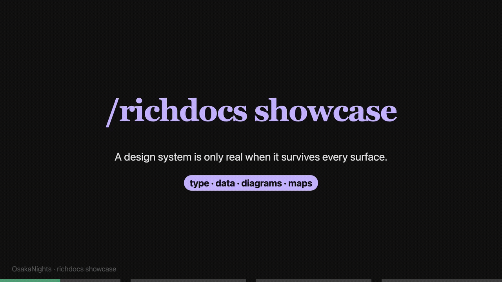
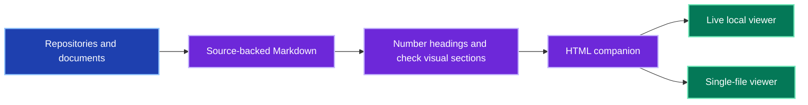
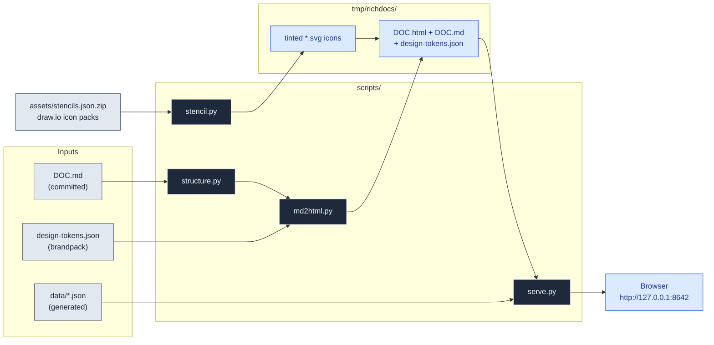

# richdocs

Generate rich, interactive HTML companions to markdown discovery documents —
and serve them reliably on localhost. The markdown stays the committed source
of truth; the companion adds theme-aware mermaid, data-driven cytoscape
graphs and plotly charts, tinted cloud-provider icons from a vendored stencil
library, and an injectable design-tokens brandpack.



The showcase exercises the full visual surface in one animated tour.

## Architecture



Editable Markdown remains the source; live and inline HTML provide two viewing modes.

<details>
<summary>Complete workflow and supporting components</summary>



</details>

## Quickstart

**In Claude:**

```
/richdocs html+inline discovery repo-a repo-b https://docs.example.org/system
/richdocs TARGET_ARCHITECTURE.md
```

Use `md`, `html+live`, or `html+inline` with `discovery` (alias `systems view`)
to research repositories and source documents, then author a systems guide.
The Markdown remains editable in every mode. See
[`resources/discovery.md`](resources/discovery.md) for the document type;
[`resources/upgrade-recipes.md`](resources/upgrade-recipes.md) covers existing
documents.

**Direct scripts (from repo root, never `cd`):**

`{SKILLS_ROOT}` means the absolute parent directory of the installed `richdocs/` skill.
Resolve it from the active harness's supplied skill location and substitute it before running these commands.
Quote the substituted path when it contains spaces.

```bash
uv run --no-project {SKILLS_ROOT}/richdocs/scripts/md2html.py TARGET_ARCHITECTURE.md
uv run --no-project {SKILLS_ROOT}/richdocs/scripts/serve.py tmp/richdocs --open
```

**Escape hatch (one shareable file, no server):**

```bash
uv run --no-project {SKILLS_ROOT}/richdocs/scripts/md2html.py REVIEW.md --inline
open tmp/richdocs/REVIEW.html
```

## Document structure

Richdocs authors numbered Markdown headings in every output mode.
Each chart or diagram has a descriptive heading section containing only that visual.

```bash
uv run --no-project {SKILLS_ROOT}/richdocs/scripts/structure.py DOC.md --fix-headings
```

The helper updates heading numbers and reports visual sections the agent must correct.
Run it without `--fix-headings` for a read-only compliance check.
Numbering is idempotent and shared by the Markdown, HTML headings and contents sidebar.
Conversion-only requests preserve the supplied source and report structure failures before rendering.

## Reference

| Piece | What it does |
|-------|--------------|
| `scripts/structure.py` | Number headings and reject visuals without a dedicated heading section |
| `scripts/md2html.py` | Markdown → HTML companion; multi-file live mode or `--inline` single file |
| `scripts/serve.py` | `127.0.0.1` server with `Cache-Control: no-store`; fixes `file://` fetch blocking |
| `scripts/stencil.py` | Query/extract tinted SVG icons from the vendored draw.io packs |
| `assets/stencils.json.zip` | AWS/GCP/Azure/K8s icon library (`assets/NOTICE` for provenance) |
| `assets/design-tokens.json` | Default neutral brandpack — edit the copy in the output dir to re-skin |
| `resources/*.md` | Deep dives: discovery, existing-document upgrades, serving, stencils, rich blocks |

A document with three or more headings gets a contents sidebar, built from its
headings on every render, with a stable anchor per heading. The sidebar collapses
to a rail, its branches fold level by level, and each article section folds in
place. The theme showcase shares the same sidebar.

Every diagram opens full screen: click a Mermaid diagram, SVG or image, or use a
graph's **Full screen** button. There the wheel zooms deep and a drag pans. In the
page, Ctrl or Cmd + wheel (or a pinch) zooms a diagram in place.

Fenced ` ```cytoscape ` and ` ```plotly ` blocks inside the markdown render
as interactive canvases; a block body of `{ "data": "path.json" }` pulls an
external data file at refresh time. See `resources/rich-blocks.md`.

## Troubleshooting

| Symptom | Cause → fix |
|---------|-------------|
| Blank page, console shows `CORS`/`file://` fetch error | Opened multi-file output directly → run `serve.py`, or regenerate with `--inline` |
| Edits to the `.md` don't show | Editing the *source* doc, not the copy in the output dir → re-run `md2html.py`, or edit `tmp/richdocs/<stem>.md` |
| Dark page with white charts | Forked template dropped the canvas re-theme → theme flips must restamp `data-theme` AND re-feed canvas palettes |
| `stencil.py extract` exits 1 | Unknown id (they contain spaces — quote it); use the suggested close matches |
| Port busy error | Another `serve.py` running → different `--port`, or reuse the running one |
| Charts empty offline | CDN libs unreachable → network required; blocks degrade to visible code/error, never silently |

## For maintainers

Design rationale, ADR log, and gotchas: [`AGENTS.md`](AGENTS.md). Dev loop:
`make -C {SKILLS_ROOT}/richdocs/scripts fix ci`.

Python scripts and tests must keep each function at cognitive complexity 15 or below.
The `lint` and `ci` targets enforce this with Complexipy, configured in `scripts/pyproject.toml`.
