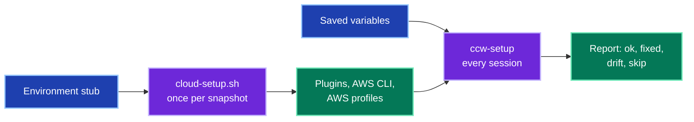
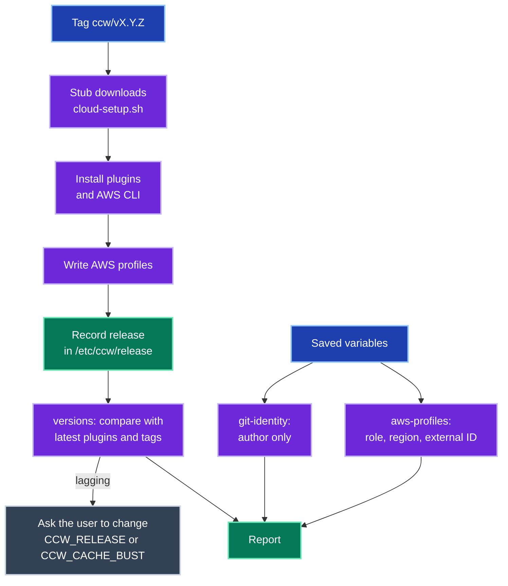

# ccw-setup

Set up a Claude Code cloud session, also called a Claude Cloud Worker.
The environment's setup script prepares the machine once per cached snapshot.
This skill applies what only the running session can, and reports what changed.

## Use it

```text
/ccw-setup          check and apply everything
/ccw-setup check    report drift, change nothing
```

- `git-identity` sets the commit author from saved variables and leaves the signing committer alone.
- `aws-profiles` writes the session's AWS profiles, including an admin profile's external ID.
- `versions` reports when the installed plugins or the pinned setup-script release lag the latest.

Rerunning on a session already in order changes nothing.

## Set up an environment

Do these steps once per person.
After that, every new cloud session starts ready, and `/ccw-setup` finishes the rest.

### 1. Create the AWS identity and role

- **Create an IAM user for the worker.** Give it one permission: `sts:AssumeRole` on the worker role.
  Its access keys are stored in plain text in the environment, so keep them low-privilege.
- **Create the worker role.** Grant it what the sessions need, and let the IAM user assume it:

  ```json
  {
    "Effect": "Allow",
    "Principal": { "AWS": "arn:aws:iam::111122223333:user/example-worker" },
    "Action": "sts:AssumeRole"
  }
  ```

- **Admin access needs a second role.** Add an `sts:ExternalId` condition to its trust policy, and keep the external ID secret.

### 2. Create the cloud environment

In Claude Code on the web, create a personal environment, for example `CCW-Developer`.

- **Allow the hosts the scripts reach.** Full network access also works.
  - `github.com` for the plugin marketplace.
  - `raw.githubusercontent.com` for the setup script and version check.
  - `awscli.amazonaws.com` for the AWS CLI installer.
  - The AWS STS endpoints, for assuming the role.
- **Add the saved variables:**

| Variable | Required | Value |
|---|---|---|
| `AWS_ACCESS_KEY_ID`, `AWS_SECRET_ACCESS_KEY` | Yes | The worker IAM user's access key |
| `CCW_ROLE_ARN` | Yes | The worker role's ARN |
| `CCW_AWS_REGION` | Optional | Your AWS region |
| `CCW_GIT_AUTHOR_NAME` | Optional | Your name, shown as the commit author |
| `CCW_GIT_AUTHOR_EMAIL` | Optional | Defaults to your Claude account email |
| `CCW_ADMIN_ROLE_ARN`, `CCW_ADMIN_EXTERNAL_ID` | Admin only | The admin role and its external ID |

### 3. Paste the setup script

- **Copy [the setup script stub](scripts/cloud-setup-stub.sh)** into the environment's setup script.
- **Fill in its values.** Set `CCW_RELEASE` to the latest `ccw/vX.Y.Z` tag, and `CCW_AWS_REGION` and `CCW_ROLE_ARN` to yours.
- **Never put the external ID in it.** The setup script is stored in plain text.

### 4. Start a session and check it

1. Start a new session on the environment.
   The first start builds the machine snapshot, so it takes longer.
2. Run `/ccw-setup`.
   Expect `ok` or `fixed` rows, and `skip` for pieces you left out.
3. Run `aws sts get-caller-identity --profile ccw`.
   It should name the worker role.

When `/ccw-setup` reports a lagging release, bump `CCW_RELEASE` or `CCW_CACHE_BUST` in the setup script.

## Machine, then session



The setup script cannot read saved variables, so the session finishes what it starts.

<details>
<summary>Complete flow, including the release check</summary>



</details>

## Requirements and boundaries

- `uv` runs the check script; `git`, `curl` and the AWS CLI are called when present.
- The skill never edits the cloud environment; it names the change and the user approves it.
- Secret values, such as the external ID, are written but never printed.

## Reference

- [Operating instructions](SKILL.md)
- [Events, environments and releases](resources/cloud-setup.md)
- [Setup script stub](scripts/cloud-setup-stub.sh)
