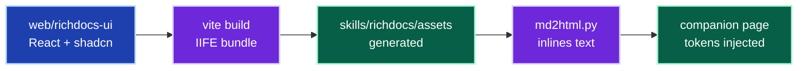

# richdocs-ui

The dev-time UI Build for the richdocs viewer and theme showcase.
It is a Vite, React, Tailwind v4 and shadcn project that lives outside `skills/`, so the plugin mirror never ships it.
Only its built output ships, in `skills/richdocs/assets/`.



## Commands

```sh
make -C web/richdocs-ui ci     # typecheck, unit tests, build
make -C web/richdocs-ui dev    # live dev server on 127.0.0.1:4174
make ui-ci                     # the same gate, from the repo root
```

## Theme injection contract

The bundle carries no brand.
At runtime the page writes one rule per mode, `:root[data-theme=light|dark] { --background: ...; }`, from its design tokens (`src/theme/tokens.ts`).
The brand's `theme.css` follows the bundle CSS.
Both beat the neutral defaults in `src/styles.css`, which sit at zero specificity.

- **Variables:** the shadcn colour roles, `--radius` and `--ring`, as listed in `src/theme/tokens.ts`.
- **Extensions:** `--link` for text-safe brand colour, plus the three font families.
- **Dark mode:** follows `data-theme` on `<html>`, not a `.dark` class.
- **Aliases:** the pre-shadcn `--rd-*` names resolve to the shadcn variables for one release, so existing brand CSS keeps working.

## Output contract

- **The build writes straight into `skills/richdocs/assets/`**: `viewer.html` from `src/viewer/shell.html`, plus `viewer.bundle.js` and `viewer.bundle.css`.
- **Committed output must match the source**, and `make ui-ci` fails when a rebuild changes it.
- **One IIFE file and one CSS file per entry**, inlined verbatim by the generator, so no ES modules, chunks or asset URLs.
- **No `{{` in any bundle**, because only the HTML shell carries placeholders.
- **Heavy libraries stay on pinned CDNs**, loaded lazily by the page; only React and the shadcn primitives are bundled.
- **Tailwind scans `src/` only**, so a previous build never feeds the next one.

## Viewer seams

- **React owns the header** and the ids the classic helpers look up, pinned by `src/viewer/Header.test.tsx`.
- **The skill's classic helpers own the rest**: the `viewer-*.js` files run before the bundle, because the showcase shares them.
- **Rendered markdown keeps browser defaults**: `src/viewer/viewer.css` reverts Tailwind's reset inside the article, sidebar and zoom modal.
- **The dev page stands in for md2html**: `src/dev.ts` loads the helpers and a sample document.

## Components

shadcn primitives live in `src/components/ui/`.
Bespoke components are curated in the `jpeakai/ui` registry and installed from it at a pinned commit.
